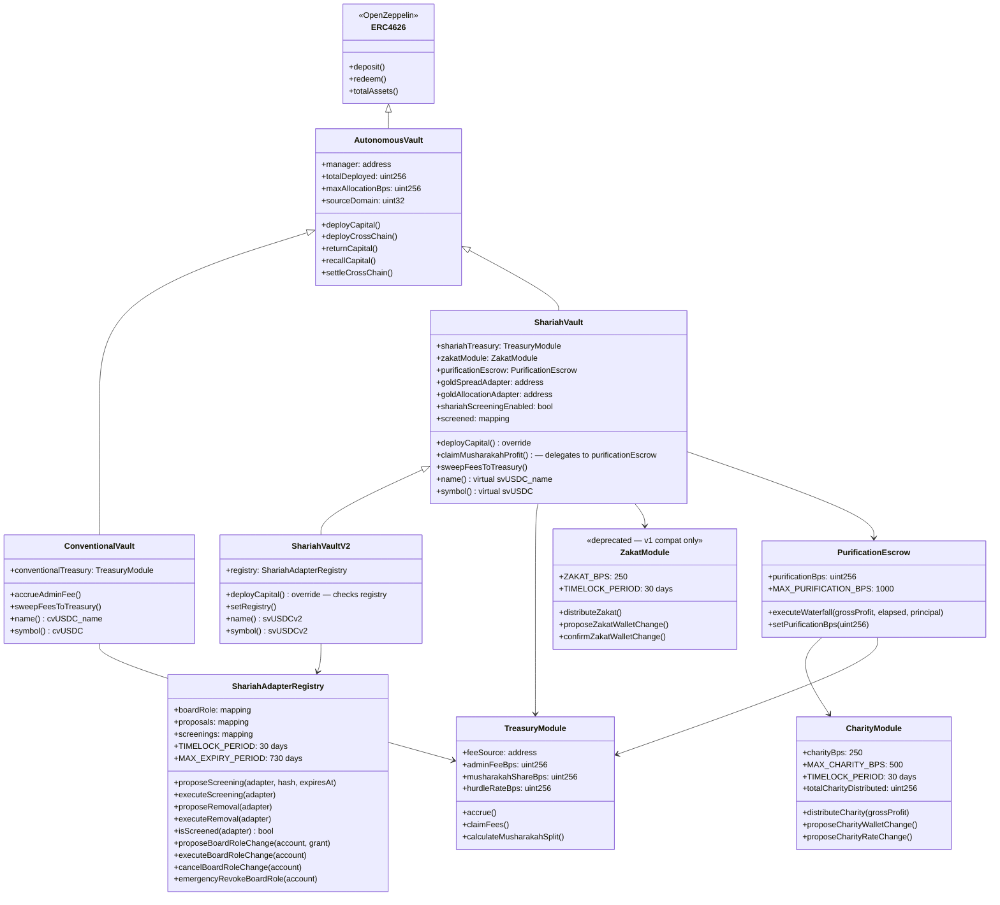
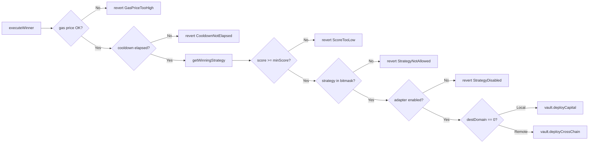
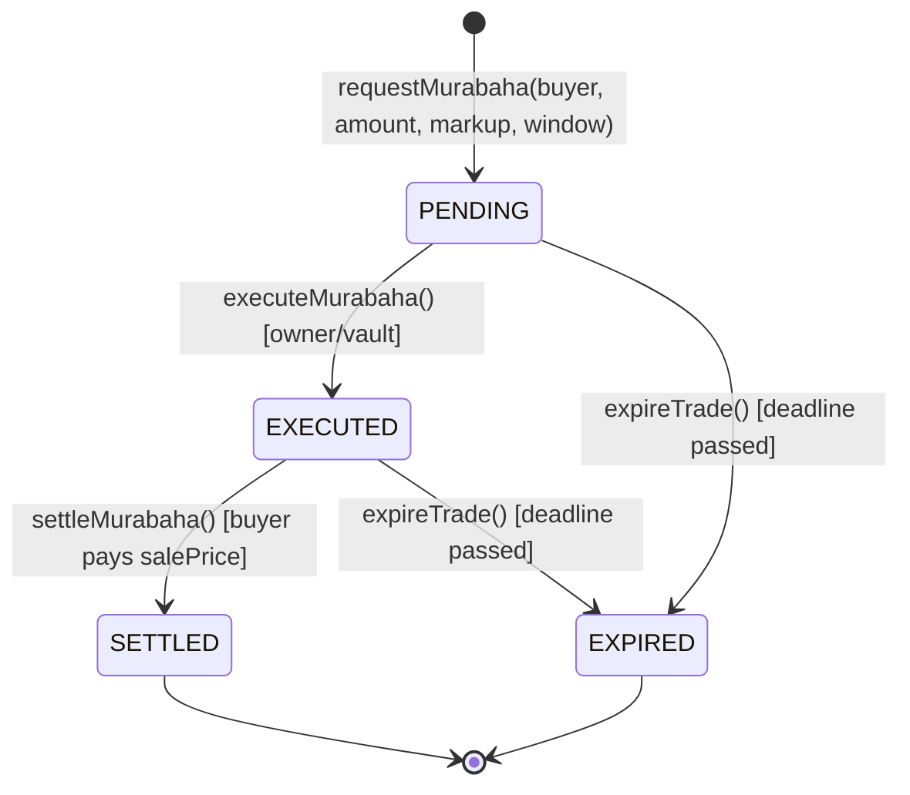
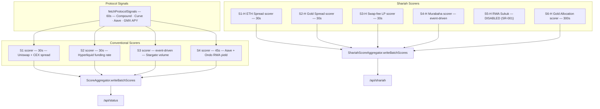
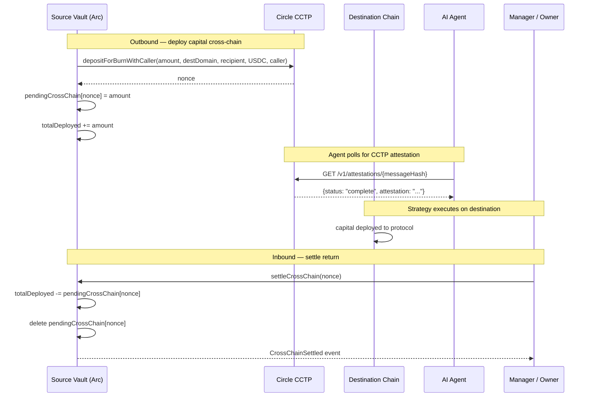
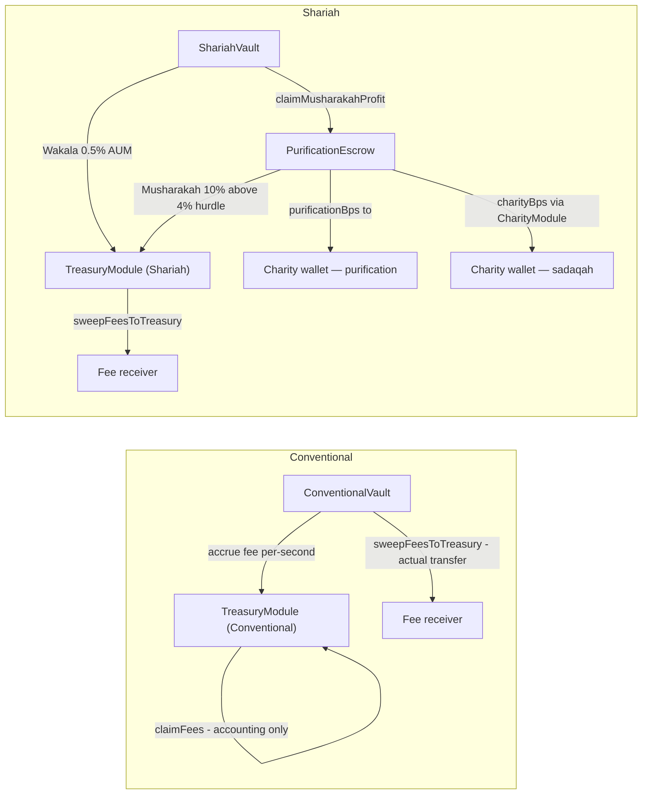
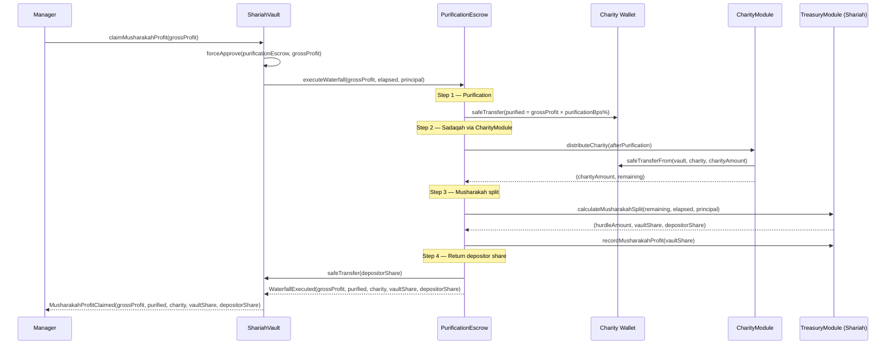

# DeFiVault Finance

**Autonomous, AI-powered DeFi capital allocation on Arc Testnet**  
Live at [defivault.finance](https://defivault.finance) · USDC-native

DeFiVault is an ERC-4626 vault protocol with four risk tiers across two communities — Conventional and Shariah. An on-chain AI agent continuously scores strategies, routes capital through protocol adapters, and executes the winning strategy on every cycle. All fees are transparent and on-chain; Shariah vaults auto-route charitable contributions before any profit split.

**Current revision (Oct 2026):** Phases 2 and 3 complete (Tasks A–F, B, D, E; G1–G4 safety fixes). OUSG/BUIDL removed from Shariah tier (SR-001); gold exchanges enforced as atomic single-transaction swaps for yad bi yad compliance (S2-H); S6-H XAUT Gold Allocation adapter with Chainlink oracle (round-completeness checked), pool deviation guard, and 30-day timelock on all board-settable parameters; combined gold cap 30%; GoldAllocationAdapter.recall() never reverts on stale oracle (G1). CharityModule + PurificationEscrow waterfall replaces ZakatModule; purification (disposal of non-compliant income) tracked separately from sadaqah charitable contribution. SC Malaysia screening engine with 11 SC-SAC rules; ShariahVaultV2 with ShariahAdapterRegistry (board-timelocked pronouncement hash + expiry per adapter; board role changes require board co-proposal + 30-day timelock, G4). Migration UI and APY estimator (P10/P50/P90). 338 tests green. Open board review items SR-001 to SR-011 (none yet approved) in `docs/agents/SHARIAH_REVIEW.md`.

---

## Table of Contents

1. [Architecture Overview](#architecture-overview)
2. [Vault Tiers](#vault-tiers)
3. [Contract Hierarchy](#contract-hierarchy)
4. [Core Contracts](#core-contracts)
5. [Strategy Adapters](#strategy-adapters)
6. [Agent Scoring System](#agent-scoring-system)
7. [Execution Workflow](#execution-workflow)
8. [Cross-Chain Flow](#cross-chain-flow)
9. [Shariah Compliance Workflow](#shariah-compliance-workflow)
10. [Fee Architecture](#fee-architecture)
11. [Charitable Contribution Waterfall](#charitable-contribution-waterfall)
12. [Security Model](#security-model)
13. [Test Coverage](#test-coverage)
14. [Deployment](#deployment)

---

## Architecture Overview

```mermaid
graph TB
    subgraph UI ["DeFiVault Frontend (React + Vite)"]
        LP[Landing Page]
        VP[Vault Picker]
        SP[Strategies Page]
        DP[Dashboard]
    end

    subgraph Agent ["AI Agent Server (Express)"]
        SA[Strategy Scorers]
        SS[Shariah Scorers]
        CP[CCTP Attestation Poller]
        SC_ENG[Screening Engine — 11 SC-SAC rules]
        AC["API: /api/status · /api/shariah · /api/screening · /api/charity · /api/apy"]
    end

    subgraph Conventional ["Conventional Vaults"]
        CV_P[ConventionalVault · Passive]
        CV_A[ConventionalVault · Aggressive]
        RTE_P[RiskTieredExecutor · PASSIVE]
        RTE_A[RiskTieredExecutor · AGGRESSIVE]
        AGG[ScoreAggregator]
        CT[TreasuryModule · Conventional]
    end

    subgraph Shariah ["Shariah Vaults"]
        SV_C[ShariahVault · Conservative]
        SV_D[ShariahVault · Dynamic]
        SV_V2[ShariahVaultV2 · Registry-gated]
        RTE_SC[RiskTieredExecutor · SHARIAH_CONSERVATIVE]
        RTE_SD[RiskTieredExecutor · SHARIAH_DYNAMIC]
        SAGG[ShariahScoreAggregator]
        ST[TreasuryModule · Shariah]
        ZM["ZakatModule (deprecated — v1 compat)"]
        CM[CharityModule]
        PE[PurificationEscrow]
        REG[ShariahAdapterRegistry]
    end

    subgraph Adapters ["Protocol Adapters"]
        COMP[CompoundAdapter]
        CURVE[CurveAdapter]
        AAVE[AaveLoopAdapter]
        GMX[GmxAdapter]
        HLP[HalalLPAdapter]
        MUR[CommodityMurabahaAdapter]
        GEA[GoldExchangeAdapter S2-H]
        GAA[GoldAllocationAdapter S6-H]
        RWA["RwaYieldAdapter (deprecated SR-001)"]
    end

    CCTP[Circle CCTP · TokenMessengerV2]

    UI --> Agent
    SA --> AGG
    SS --> SAGG
    RTE_P --> CV_P
    RTE_A --> CV_A
    RTE_SC --> SV_C
    RTE_SD --> SV_D
    CV_P --> CT
    CV_A --> CT
    SV_C --> ST
    SV_C -.->|v1 compat| ZM
    SV_D --> ST
    SV_D -.->|v1 compat| ZM
    SV_C --> PE
    SV_D --> PE
    SV_V2 --> REG
    SV_V2 --> PE
    PE --> CM
    PE --> ST
    SC_ENG --> REG
    CV_P --> COMP
    CV_P --> CURVE
    CV_A --> AAVE
    CV_A --> GMX
    SV_C --> HLP
    SV_C --> GEA
    SV_C --> GAA
    SV_D --> HLP
    SV_D --> MUR
    SV_D --> GEA
    SV_D --> GAA
    CV_P --> CCTP
    CV_A --> CCTP
    SV_C --> CCTP
    SV_D --> CCTP
```



---

## Vault Tiers

| Tier | Type | Strategies | Min Score | Cooldown | Fee Model |
|---|---|---|---|---|---|
| **Passive** | Conventional | S1 Cross-chain Spread, S4 RWA Yield | 80 | 2h | 0.75% AUM |
| **Aggressive** | Conventional | S1–S4 all | 60 | 30m | 0.75% AUM |
| **Conservative** | Shariah | S2-H Gold Spread, S3-H Swap-fee LP, S6-H Gold Allocation | 80 | 2h | 0.5% Wakala |
| **Dynamic** | Shariah | S1-H through S4-H + S6-H (S5-H retired) | 70 | 1h | 0.5% Wakala + 10% Musharakah |

Each tier is a separate vault deployment (independent NAV, independent share token) — capital from one tier never mixes with another.

---

## Contract Hierarchy



---

## Core Contracts

### `AutonomousVault.sol`

Base ERC-4626 vault. All four tier vaults inherit this.

| Feature | Detail |
|---|---|
| Asset | USDC (6 decimals) |
| Share decimals offset | +6 (12 total) — inflation-attack protection |
| Max allocation cap | 80% of `totalAssets()` by default (configurable up to 95%) |
| Manager role | Single address that can call `deployCapital` and `deployCrossChain` |
| CCTP | Immutable `sourceDomain` set at construction; `tokenMessenger` configurable |
| Cross-chain accounting | `pendingCrossChain[nonce]` tracks outbound capital until `settleCrossChain` |

Key functions:

```solidity
function deployCapital(address strategy, uint256 amount, bytes calldata data) public virtual
function deployCrossChain(uint32 destDomain, bytes32 recipient, uint256 amount) external
function returnCapital(address strategy, uint256 amount) external
function recallCapital(address adapter, uint256 amount) external
function settleCrossChain(uint64 nonce) external
```

### `ConventionalVault.sol`

Inherits `AutonomousVault`. Adds admin fee accrual (0.75% AUM, pro-rated per second).

### `ShariahVault.sol`

Inherits `AutonomousVault`. Overrides `deployCapital` to enforce:
1. Adapter must be in `screened` mapping
2. Asset must be in `permittedAssets` mapping (USDC, ETH, PAXG — OUSG and BUIDL removed per SR-001)
3. Wakala fee accrued on every deployment
4. Combined gold cap: `goldSpreadAdapter.currentValue() + goldAllocationAdapter.currentValue() <= MAX_GOLD_BPS * totalAssets() / 10_000`

`claimMusharakahProfit(grossProfit)` now delegates to `purificationEscrow.executeWaterfall()` — reverts `PurificationEscrowNotSet` if escrow not wired. `MusharakahProfitClaimed` event emits 5 params: `(grossProfit, purified, charity, vaultShare, depositorShare)`.

### `ShariahVaultV2.sol`

Inherits `ShariahVault`. Adds on-chain governance via `ShariahAdapterRegistry`. Overrides `deployCapital` to check `registry.isScreened(strategy)` before the inherited checks — reverts `NotScreened` when `pronouncementHash == 0`, reverts `ScreeningExpired` when `block.timestamp >= expiresAt`. V1 vaults remain live; no forced migration.

### `ShariahAdapterRegistry.sol`

Governance-gated adapter registry. Board members may propose and execute screening changes with a 30-day timelock. Board membership itself requires a board-member co-proposal plus 30-day timelock (`proposeBoardRoleChange` / `executeBoardRoleChange`); the owner retains only `emergencyRevokeBoardRole` (instant removal only — cannot grant without the board, G4). Each screening entry records a `pronouncementHash` (bytes32) and `expiresAt` (uint256 timestamp). `isScreened(adapter)` returns true only when both are non-zero and not expired. `MAX_EXPIRY_PERIOD = 730 days`.

### `CharityModule.sol`

Routes charitable contributions (sadaqah) from Shariah gross profit to the board-designated charity wallet. Default rate: `charityBps = 250` (2.5%), hard cap `MAX_CHARITY_BPS = 500` (5%). Both wallet address and rate require a 30-day timelock to change. Only the bound vault (or PurificationEscrow) can call `distributeCharity`.

### `PurificationEscrow.sol`

Enforces the four-step Shariah profit waterfall on every `claimMusharakahProfit` call:
1. **Purification** — `purificationBps` of gross profit sent directly to CharityModule's charity wallet
2. **Sadaqah** — `charityBps` of the remaining profit routed via CharityModule
3. **Musharakah split** — remaining divided by TreasuryModule (10% vault share above 4% hurdle)
4. **Depositor return** — depositor share transferred back to vault

Invariant proven by fuzz: `purified + charity + vaultShare + depositorShare == grossProfit` (512 runs).

### `RiskTieredExecutor.sol`

One instance per vault tier. Reads the winning strategy from the aggregator and routes execution.



Tier parameters:

| Tier | `minScoreToExecute` | `executionCooldown` | `maxGasPrice` | `strategyMask` |
|---|---|---|---|---|
| PASSIVE | 80 | 2h | 20 gwei | `9` — `0b001001` (bits 0+3) |
| AGGRESSIVE | 60 | 30m | 50 gwei | `15` — `0b001111` (bits 0–3) |
| SHARIAH_CONSERVATIVE | 80 | 2h | 30 gwei | `38` — `0b100110` (bits 1+2+5) |
| SHARIAH_DYNAMIC | 70 | 1h | 30 gwei | `47` — `0b101111` (bits 0–3+5) |

### `ScoreAggregator.sol`

Stores scores for 4 conventional strategies. Ring-buffer of 10 history slots per strategy. 5-minute staleness guard.

```solidity
enum Strategy {
    STABLECOIN_SPREAD,    // S1 — USDC/USDT cross-chain
    FUNDING_RATE_ARB,     // S2 — Hyperliquid perp funding
    BRIDGE_FLOW,          // S3 — Stargate bridge flow
    LIQUIDATION_RWA       // S4 — Aave liquidation + Ondo RWA
}
```

### `ShariahScoreAggregator.sol`

Parallel aggregator for 6 Shariah strategies. Adds `strategyEnabled` bool per strategy (renamed from `shariahCertified` — "certified" is reserved for board rulings, G3) — only enabled strategies can win. Enum order is fixed (append-only); deprecated slots revert `StrategyDeprecated`.

```solidity
enum ShariahStrategy {
    ETH_SPREAD,       // 0  S1-H USDC/ETH cross-chain spread      — enabled (testnet); SR-007 pending
    GOLD_SPREAD,      // 1  S2-H PAXG/USDC atomic swap             — enabled (testnet); SR-005 pending
    HALAL_LP,         // 2  S3-H Uniswap V3 swap-fee income        — enabled (testnet); SR-011 pending (contract file kept as HalalLPAdapter.sol — G9)
    MURABAHA,         // 3  S4-H Commodity Murabaha                 — enabled (testnet); SR-004 pending
    RESERVED_4,       // 4  S5-H (RWA/Sukuk) — DEPRECATED (SR-001); writeScore(4,...) reverts
    GOLD_ALLOCATION   // 5  S6-H XAUT spot position                 — disabled until SR-008 approved
}
```

### `TreasuryModule.sol`

Accounting-only fee ledger. Actual USDC transfer happens only when the vault calls `sweepFeesToTreasury`.

- **Conventional**: `adminFeeBps = 75` (0.75%), `musharakahShareBps = 0`
- **Shariah**: `adminFeeBps = 50` (0.5% Wakala), `musharakahShareBps = 1000` (10%), `hurdleRateBps = 400` (4%)

`claimFees` is accounting-only — it decrements `pendingFees` and emits the event; the caller must separately trigger `sweepFeesToTreasury` on the vault to move actual tokens. Fee sweeps are capped to `pendingFees` to prevent draining depositor principal.

### `ZakatModule.sol`

**Deprecated for new deployments.** Kept live for v1 vault history and redemption continuity. Do not wire into new vaults — use `CharityModule` + `PurificationEscrow` instead. The fixed `ZAKAT_BPS = 250` (2.5%) rate and 30-day wallet timelock remain intact for v1 vault operations.

### `PositionTracker.sol`

Tracks open positions per vault, including cross-chain `destinationDomain`, PnL accounting, and position lifecycle (OPEN → CLOSED).

---

## Strategy Adapters

All adapters implement `IStrategyAdapter`:

```solidity
interface IStrategyAdapter {
    function deploy(uint256 amount) external returns (uint256 deployed);
    function recall(uint256 amount) external returns (uint256 returned);
    function currentValue() external view returns (uint256);
    function protocolName() external view returns (string memory);
    function vault() external view returns (address);
}
```

Only the vault can call `deploy` and `recall` (enforced by `onlyVault` modifier on every adapter).

| Adapter | Protocol | Tier(s) | Strategy | Status |
|---|---|---|---|---|
| `CompoundAdapter` | Compound V3 Comet | Passive | S1 | Active |
| `CurveAdapter` | Curve 3pool LP | Passive | S4 | Active |
| `AaveLoopAdapter` | Aave V3 2x leverage | Aggressive | S2 | Active |
| `GmxAdapter` | GMX V2 GLP | Aggressive | S3 | Active |
| `HalalLPAdapter` | Uniswap V3 USDC/ETH | Conservative + Dynamic | S3-H | Active |
| `CommodityMurabahaAdapter` | Murabaha trade lifecycle | Dynamic | S4-H | Active |
| `GoldExchangeAdapter` | PAXG/USDC atomic swap (Uniswap V3) | Conservative + Dynamic | S2-H | Active |
| `GoldAllocationAdapter` | XAUT spot position (oracle + Uniswap V3) | Conservative + Dynamic | S6-H | Pending SR-008; `recall()` never reverts on stale oracle (G1) |
| `RwaYieldAdapter` | OUSG / BUIDL direct hold | — | S5-H | Deprecated (SR-001); unscreened from Shariah tier |

### `CommodityMurabahaAdapter` — Trade Lifecycle



- Max 50 concurrent active trades (DoS guard)
- O(1) removal via index mapping + swap-and-pop
- Buyer pays `costAmount + markup` directly to vault on settlement

---

## Agent Scoring System

The Express agent (`server/agent.ts`) runs continuously alongside the frontend. Each strategy has its own scorer with a configurable interval.



All agent intervals and thresholds are hot-reloadable via `POST /api/config`.

---

## Execution Workflow

```mermaid
sequenceDiagram
    participant Agent as AI Agent
    participant Executor as RiskTieredExecutor
    participant Aggregator as ScoreAggregator
    participant Vault as ConventionalVault / ShariahVault
    participant Adapter as Protocol Adapter
    participant CCTP as Circle CCTP

    Agent->>Aggregator: writeScore(strategy, score, dataHash, destDomain)
    Agent->>Executor: executeWinner()
    Executor->>Executor: check gas price ≤ maxGasPrice
    Executor->>Executor: check block.timestamp ≥ lastExecution + cooldown
    Executor->>Aggregator: getWinningStrategy()
    Aggregator-->>Executor: (strategy, score, destinationDomain)
    Executor->>Executor: check score ≥ minScoreToExecute
    Executor->>Executor: check strategy in strategyMask
    alt Local execution (destinationDomain == 0)
        Executor->>Vault: deployCapital(adapter, amount, data)
        Vault->>Adapter: safeTransfer(amount)
        Vault->>Adapter: deploy(amount)
        Adapter-->>Vault: deployed
        Vault->>Vault: totalDeployed += amount
    else Cross-chain execution
        Executor->>Vault: deployCrossChain(destDomain, recipient, amount)
        Vault->>CCTP: depositForBurnWithCaller(amount, destDomain, recipient, USDC, destCaller)
        CCTP-->>Vault: nonce
        Vault->>Vault: pendingCrossChain[nonce] = amount
    end
    Executor->>Executor: lastExecution = block.timestamp
    Executor-->>Agent: ExecutionTriggered event
```



---

## Cross-Chain Flow



---

## Shariah Compliance Workflow


**Permitted Shariah assets:** USDC, ETH, PAXG — OUSG and BUIDL removed per SR-001  
**XAUT:** S6-H adapter written; `strategyEnabled[5]` is `false` until SR-008 accepted by the board  
**Prohibited actions:** Aave lending (riba), perp funding payments, front-running MEV, non-atomic gold transfers across chain boundaries (`goldCrossChainBlocked = true`)  
**V2 registry requirement:** `pronouncementHash != 0` AND `block.timestamp < expiresAt` — board must execute screening with the hash of the protocol's Shariah board pronouncement before any adapter is usable in V2 (SC-SAC resolutions are cited as rule sources in `shariah-rules.yaml`; per-adapter approvals come from the vault's own Shariah board)

---

## Fee Architecture



| Fee | Rate | Mechanism | When |
|---|---|---|---|
| Admin fee (Conventional) | 0.75% AUM / year | Pro-rated per second, accounting-only | On every `deployCapital` |
| Wakala fee (Shariah) | 0.5% AUM / year | Pro-rated per second | On every Shariah `deployCapital` |
| Musharakah profit share | 10% of profit above 4% hurdle | Applied via PurificationEscrow on `claimMusharakahProfit` | When manager claims |
| Purification (disposal of non-compliant income) | Board-set `purificationBps` (default 0; max 10%) | Step 1 of waterfall; sent directly to charity wallet | Before any Musharakah split |
| Charitable contribution (sadaqah) | Board-set `charityBps` (default 2.5%; max 5%) | Step 2 of waterfall; routed via CharityModule | After purification, before split; **30-day timelock** via `proposeCharityRateChange` |
| Purification rate setter | `PurificationEscrow.setPurificationBps` (default 0%; max 10%) | `onlyOwner`, **no timelock** (asymmetric with charityBps — see SR-G6 note) | Immediate; board should consider adding a timelock |

---

## Charitable Contribution Waterfall

The four-step waterfall is enforced by `PurificationEscrow.executeWaterfall()` on every `claimMusharakahProfit` call. The fuzz invariant `purified + charity + vaultShare + depositorShare == grossProfit` is proven at 512 runs.



**CharityModule wallet and rate changes require a 30-day timelock:**

```
CharityModule.proposeCharityWalletChange(newWallet)  →  wait 30 days  →  confirmCharityWalletChange()
CharityModule.proposeCharityRateChange(newBps)        →  wait 30 days  →  confirmCharityRateChange()
```

Note: `PurificationEscrow.setPurificationBps` is `onlyOwner` with **no timelock** (asymmetric — see SR-G6 in `SHARIAH_REVIEW.md`).

The deprecated `ZakatModule` remains deployed for v1 vault compatibility and is not wired into any new vault. V1 redemptions remain available at NAV with no forced migration.

---

## Security Model

| Threat | Mitigation |
|---|---|
| Inflation attack | `_decimalsOffset = 6` on all vaults (shares have 12 decimals, USDC has 6) |
| Principal drain via fee sweep | `sweepFeesToTreasury` capped to `TreasuryModule.pendingFees` |
| Shariah screening bypass | `deployCapital` overridden in `ShariahVault`; base function is `virtual` |
| Unlimited trade DoS | `CommodityMurabahaAdapter` enforces `MAX_ACTIVE_TRADES = 50` |
| O(n) removal DoS | Active trade removal uses index mapping + swap-and-pop (O(1)) |
| Over-allocation | `maxAllocationBps` cumulative cap (default 80%) enforced on every deployment |
| Stale oracle execution | 5-minute staleness guard in both score aggregators |
| Gas price manipulation | `maxGasPrice` guard per tier in `RiskTieredExecutor` |
| Cross-chain double-settle | `settleCrossChain` deletes `pendingCrossChain[nonce]` atomically |
| Same-domain CCTP loop | `deployCrossChain` reverts `SameDomainDeploy` if `destDomain == sourceDomain` |
| Charitable wallet rug | 30-day timelock on all `CharityModule` wallet + rate changes; `ZakatModule` also timelocked for v1 compat |
| RWA lending exposure | `RwaYieldAdapter` has no approve-for-lending function by design |
| Unscreened adapter in V2 | `ShariahAdapterRegistry.isScreened` checks hash non-zero AND expiry; board + 30-day timelock to screen |
| Screening expiry bypass | `ScreeningExpired` revert when `block.timestamp >= expiresAt`; max expiry 730 days enforced at proposal |
| Combined deduction drain | `MAX_COMBINED_DEDUCTION_BPS = 5000`; PurificationEscrow reverts if purification + charity would exceed 50% |
| Gold cap breach | `ShariahVault.deployCapital` sums `goldSpreadAdapter.currentValue() + goldAllocationAdapter.currentValue()` and reverts `GoldCapExceeded` when combined > `MAX_GOLD_BPS` (30%) |
| Non-atomic gold cross-chain | `ShariahVault.deployCrossChain` reverts `NonAtomicGoldExchange` when `goldCrossChainBlocked = true` |
| Stale Chainlink gold price | `GoldAllocationAdapter._getOraclePrice` checks `startedAt > 0`, `answeredInRound >= roundId`, `answer > 0`, and `block.timestamp - updatedAt <= maxStalenessSecs` |
| Pool-oracle gold deviation (deploy) | `GoldAllocationAdapter.deploy()` checks `isPriceSane()` first; reverts `OracleNotSane` if oracle is stale or pool price deviates beyond `maxDeviationBps`. New gold buys are blocked; existing positions are unaffected. |
| Pool-oracle gold deviation (recall) | `GoldAllocationAdapter.recall()` uses `_getOraclePriceSafe()` — never reverts on stale oracle. When stale, uses `totalDeployed` as conservative floor; when pool deviates, uses the lower of oracle/pool price. `vault.redeem()` always succeeds even when the gold oracle is down (G1). |
| Parameter manipulation (gold adapter) | All numeric and address params on `GoldAllocationAdapter` require 30-day timelock via `proposeParamChange` / `executeParamChange`; hard caps enforced at proposal time |
| Reentrancy in executor | `RiskTieredExecutor.executeWinner` uses `_executionLocked` guard; `lastExecutionTime` set before external calls |

---

## Test Coverage

**338 Foundry tests** (249 unit + 89 fuzz) across **25 test files**; **48 bun tests** in `server/screening/tests/`. Counts from `forge test --summary` — never hand-edited (G11).

**Foundry test suite (`forge test --fuzz-runs 512`):**

| File | Tests | Type | Coverage |
|---|---|---|---|
| `AutonomousVaultTest.t.sol` | 17 | Unit | Deposit, redeem, deploy, cap, cross-chain, pause, inflation |
| `ScoreAggregatorTest.t.sol` | 13 | Unit | Write, batch, staleness, ring-buffer, access control |
| `RiskTieredExecutorTest.t.sol` | 12 | Unit | Execute, cooldown, gas guard, bitmask, tier params |
| `TreasuryModuleTest.t.sol` | 16 | Unit | Accrue, claim, Musharakah split, bps guards |
| `ZakatModuleTest.t.sol` | 12 | Unit | Distribute, timelock, propose/confirm/cancel |
| `CommodityMurabahaAdapterTest.t.sol` | 18 | Unit | Request, execute, settle, expire, DoS guard |
| `ShariahVaultTaskATest.t.sol` | 11 | Unit | StrategyDeprecated guard, mask values (38/47), OUSG recall script |
| `GoldExchangeAdapterTest.t.sol` | 31 | Unit | Atomic swap, slippage, cross-chain block, combined cap |
| `GoldAllocationAdapterTest.t.sol` | 37 | Unit | Oracle guards, OracleNotSane (G1), deviation, timelock params, combined cap |
| `CharityModuleTest.t.sol` | 20 | Unit | Distribute, wallet + rate timelock, cap enforcement |
| `PurificationEscrowTest.t.sol` | 15 | Unit | Waterfall invariant, steps 1–4, ShariahVault integration |
| `ShariahAdapterRegistryTest.t.sol` | 19 | Unit | Screening lifecycle, board-role timelock (G4), emergencyRevoke, all custom errors |
| `ShariahVaultV2Test.t.sol` | 9 | Unit | NotScreened / ScreeningExpired, V1 compat, zero-zakatModule (G10) |
| `TaskGTest.t.sol` | 19 | Unit + Fuzz | G1 recall-on-stale (6), G3 strategyEnabled (4), G4 board-role (8), G10 (1) |
| `FuzzAutonomousVault.t.sol` | 10 | Fuzz (512 runs) | Round-trip, multi-depositor fairness, cap at all amounts |
| `FuzzScoreAggregator.t.sol` | 9 | Fuzz (512 runs) | Winner invariant, ring-buffer, staleness, access control |
| `FuzzRiskTieredExecutor.t.sol` | 10 | Fuzz (512 runs) | Score/cooldown/gas guards at all param values |
| `FuzzTreasuryModule.t.sol` | 10 | Fuzz (512 runs) | Split invariant: vaultShare + depositorShare == grossProfit |
| `FuzzZakatModule.t.sol` | 9 | Fuzz (512 runs) | Charity amount exactly 2.5%, timelock boundary, accumulation |
| `FuzzCommodityMurabaha.t.sol` | 9 | Fuzz (512 runs) | Sale price math, O(1) removal, max-trade cap |
| `FuzzGoldExchangeAdapter.t.sol` | 13 | Fuzz (512 runs) | Round-trip value, no PAXG stranded, cap invariant |
| `FuzzGoldAllocationAdapter.t.sol` | 5 | Fuzz (512 runs) | `currentValue()` precision, round-trip, gold cap invariant, timelock |
| `FuzzCharityModule.t.sol` | 6 | Fuzz (512 runs) | Arithmetic exactness, cap, timelock boundary, accumulator monotonicity |
| `FuzzPurificationEscrow.t.sol` | 4 | Fuzz (512 runs) | Waterfall invariant, zero-purification, charity proportionality |
| `FuzzShariahVaultV2.t.sol` | 4 | Fuzz (512 runs) | Migration round-trip NAV, timelock, screening expiry lifecycle, allocation cap |

**Bun screening tests (`bun test server/screening/tests/`):**

48 tests covering all 11 SC-SAC rules, RS-002 three-zone boundary (0.0499/0.05/0.051), missing data → REVIEW, verdict priority combiner, known protocol fixtures (Aave FAIL / OUSG FAIL / UniV3 PASS / PAXG REVIEW with missing ratio data (G8) / PAXG PASS with full data / Hyperliquid FAIL), and determinism guarantee.

Run the full Foundry suite:

```bash
forge test --fuzz-runs 512
```

Run the screening engine bun tests:

```bash
bun test server/screening/tests/
```

Run a single Foundry file:

```bash
forge test --match-path contracts/test/AutonomousVaultTest.t.sol -vv
```

---

## Deployment

All contracts deploy to **Arc Testnet** (chain ID 5042002) with USDC as the native gas token.

**Deploy order (respects dependency graph):**

```
1.  TreasuryModule (Conventional)                  — no deps
2.  TreasuryModule (Shariah)                       — no deps
3.  ZakatModule × 2                                — no deps (one per v1 vault; deprecated — V2 passes address(0))
4.  ScoreAggregator                                — no deps
5.  ShariahScoreAggregator (6-strategy)            — no deps   [script: RedeployShariahAggregator.s.sol]
6.  ConventionalVault (Passive)                    — needs TreasuryModule
7.  ConventionalVault (Aggressive)                 — needs TreasuryModule
8.  ShariahVault (Conservative)                    — needs TreasuryModule + ZakatModule
9.  ShariahVault (Dynamic)                         — needs TreasuryModule + ZakatModule
10. RiskTieredExecutor × 4                         — needs vault + aggregator (masks: 9 / 15 / 38 / 47)
11. Adapters × 7 (conventional + Shariah-screened)  — needs vault address
12. GoldExchangeAdapter (S2-H)                     — needs vault + MockAllocatedGold pool
13. GoldAllocationAdapter (S6-H)                   — needs vault + MockXAUT + oracle + pool [script: DeployGoldAllocation.s.sol]
14. setManager(executor) on each vault             — wires executor as manager
15. setStrategyConfig per adapter                  — configures each adapter per tier
16. setGoldSpreadAdapter / setGoldAllocationAdapter on ShariahVault
17. setEnabled(0..3, true) — testnet only; on any production chain a non-zero board pronouncement hash is required first; indices 4 and 5 remain false (SR-001 and SR-008 open)
18. CharityModule                                  — needs asset + charityWallet + vault [script: DeployShariahV2.s.sol]
19. PurificationEscrow                             — needs asset + charityModule + shariahTreasury
20. setPurificationEscrow on ShariahVault (Conservative + Dynamic)
21. ShariahAdapterRegistry                         — deployer address gets boardRole automatically in constructor; transfer deployer's board role to the real board multisig via proposeBoardRoleChange (board proposes, 30-day timelock, then execute); then emergencyRevokeBoardRole(deployer) to remove the hot key
22. ShariahVaultV2 (Conservative + Dynamic)        — needs TreasuryModule + ZakatModule(address(0)) + registry [script: DeployShariahV2.s.sol]
23. RiskTieredExecutor × 2 for V2                  — same masks (38 / 47) pointing at V2 vault addresses; without these the agent cannot autonomously deploy into V2
24. board: proposeScreening per adapter            — wait 30 days → executeScreening (one per adapter per vault)
25. setRegistry on ShariahVaultV2 if registry rotated — owner-only; 30-day timelock for re-screening
```

**Constructor args quick reference:**

```solidity
// TreasuryModule
constructor(
    "Conventional",         // treasuryType
    address(conventionalVault),  // feeSource
    address(USDC),          // asset
    75,                     // adminFeeBps (0.75%)
    0,                      // musharakahShareBps
    0,                      // hurdleRateBps
    owner                   // initialOwner
)

// ShariahVault
constructor(
    IERC20(USDC),
    owner,
    26,                     // sourceDomain (Arc Testnet CCTP domain)
    address(shariahTreasury),
    address(zakatModule)
)

// RiskTieredExecutor (PASSIVE)
constructor(
    address(passiveVault),
    address(scoreAggregator),
    RiskTier.PASSIVE,
    owner
)
```

**Key addresses (Arc Testnet):**

| Contract | Address |
|---|---|
| USDC (ERC-20, Arc Testnet) | `0x3600000000000000000000000000000000000000` |
| CCTP TokenMessengerV2 | `0x8FE6B999Dc680CcFDD5Bf7EB0974218be2542DAA` |
| Arc Testnet CCTP source domain | `26` |
| XAUT (mainnet reference only) | `0x68749665FF8D2d112Fa859AA293F07A622782F38` — not deployed on Arc Testnet; use MockXAUT for tests |

All deployed vault addresses are recorded in `docs/agents/deployed-addresses.md` after deployment.

---

## Project Structure

```
contracts/
├── AutonomousVault.sol          # Base ERC-4626 vault (pause gates on all capital paths)
├── ConventionalVault.sol        # Conventional tier (admin fee)
├── ShariahVault.sol             # Shariah tier (Wakala + Musharakah + gold cap + waterfall)
├── ShariahVaultV2.sol           # V2: registry-gated deployCapital; inherits ShariahVault
├── ShariahAdapterRegistry.sol   # On-chain adapter registry (board role + 30-day timelock)
├── CharityModule.sol            # Charitable contribution router (board-settable rate + wallet)
├── PurificationEscrow.sol       # 4-step Shariah profit waterfall (purification → sadaqah → Musharakah → depositor)
├── ScoreAggregator.sol          # 4-strategy conventional scorer
├── ShariahScoreAggregator.sol   # 6-strategy Shariah scorer (index 4 deprecated)
├── RiskTieredExecutor.sol       # Strategy router (4 tiers; reentrancy guard)
├── TreasuryModule.sol           # Fee accounting module
├── ZakatModule.sol              # DEPRECATED — v1 compat only; do not wire into new vaults
├── PositionTracker.sol          # Position lifecycle + PnL
├── IStrategyAdapter.sol         # Adapter interface
├── VaultExecutor.sol            # Legacy executor (superseded)
├── interfaces/
│   └── AggregatorV3Interface.sol  # Minimal Chainlink oracle interface
├── adapters/
│   ├── CompoundAdapter.sol         # Compound V3 Comet
│   ├── CurveAdapter.sol            # Curve 3pool LP
│   ├── AaveLoopAdapter.sol         # Aave V3 2x leverage
│   ├── GmxAdapter.sol              # GMX V2 GLP
│   ├── HalalLPAdapter.sol          # Uniswap V3 swap-fee LP (S3-H)
│   ├── CommodityMurabahaAdapter.sol # Murabaha trade lifecycle (S4-H)
│   ├── GoldExchangeAdapter.sol     # PAXG/USDC atomic swap (S2-H)
│   ├── GoldAllocationAdapter.sol   # XAUT spot + oracle guard (S6-H; 30-day timelock)
│   └── RwaYieldAdapter.sol         # OUSG/BUIDL — DEPRECATED per SR-001
├── test-helpers/
│   ├── MockERC20.sol
│   ├── MockAllocatedGold.sol       # PAXG stub (18 dec)
│   ├── MockXAUT.sol                # XAUT stub (6 dec)
│   ├── MockXauUsdAggregator.sol    # Settable XAU/USD oracle
│   └── MockUniswapV3PoolXAUT.sol  # Stripped V3 pool mock (slot0 + exactInputSingle)
├── script/
│   ├── RecallRwaFromShariah.s.sol        # Unscreen RwaYieldAdapter (Task A)
│   ├── RedeployShariahAggregator.s.sol   # Re-deploy 6-strategy aggregator (Task F)
│   ├── DeployGoldAllocation.s.sol        # Deploy mocks + adapter + wire vaults (Task F)
│   └── DeployShariahV2.s.sol             # Deploy CharityModule + PurificationEscrow + V2 vault + registry (Task E)
└── test/
    ├── *Test.t.sol              # 249 unit tests across 14 files (incl. TaskGTest.t.sol)
    └── Fuzz*.t.sol              # 89 fuzz tests across 11 files (512 runs each)

server/
├── agent.ts                     # AI agent (scoring + execution + charity/apy endpoints)
├── shariah-strategies.ts        # Shariah strategy scorers (6 strategies; S5-H disabled)
├── screening/
│   ├── shariah-rules.yaml       # 11 SC-SAC rules (5 hard-exclude, 3 ratio, 3 qualitative)
│   ├── engine.ts                # Pure screening function; verdict: PASS / REVIEW / FAIL
│   ├── sources/
│   │   ├── defi-llama.ts        # DeFiLlama data source with snapshot sink
│   │   └── protocol-profiles.ts # Static flag registry for 12 known protocols
│   └── tests/
│       └── engine.test.ts       # 48 bun tests covering all rules + boundary conditions (G8)
└── board/
    └── permitted-assets.json    # USDC/ETH/PAXG permitted; OUSG/BUIDL prohibited (SR-001)

src/
├── App.tsx                      # Router + vault-mode state
├── pages/                       # 6 route pages (includes SettingsPage with MigrationPanel)
├── components/
│   ├── CharityTracker.tsx       # Charitable contribution tracker (SR-002 pending badge)
│   ├── MigrationPanel.tsx       # V1 → V2 migration UI (two-step; APY P10/P50/P90)
│   └── ...                      # Other UI components
└── lib/shariahSim.ts            # Simulated scores (pre-deploy; 6 strategies)

docs/
├── agents/
│   ├── SHARIAH_REVIEW.md            # Open board review items SR-001 through SR-011 (none approved)
│   ├── deployed-addresses.md        # Contract addresses filled after each deploy run
│   └── shariah-vault-revision-plan.md
└── migration-v1-to-v2.md           # V1 → V2 migration guide (no forced migration)
```

---

*DeFiVault Finance — Built on [Arc Testnet](https://arc.io) · Powered by [Circle USDC](https://circle.com)*
