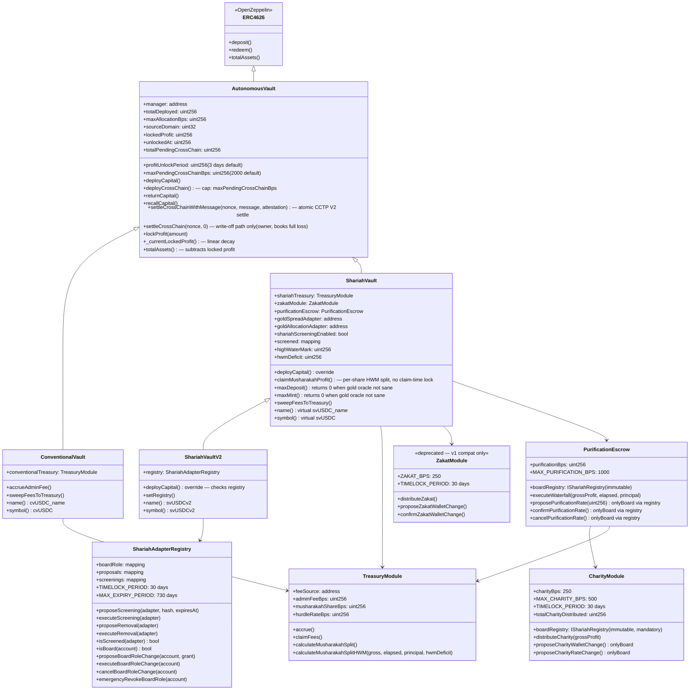
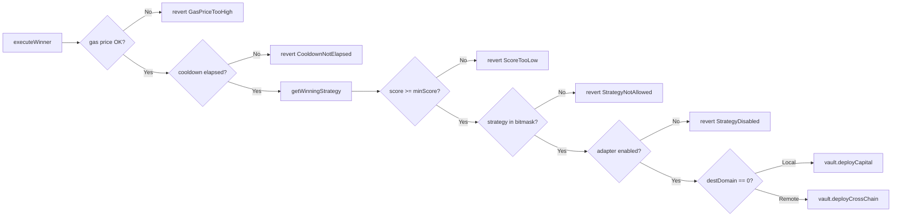
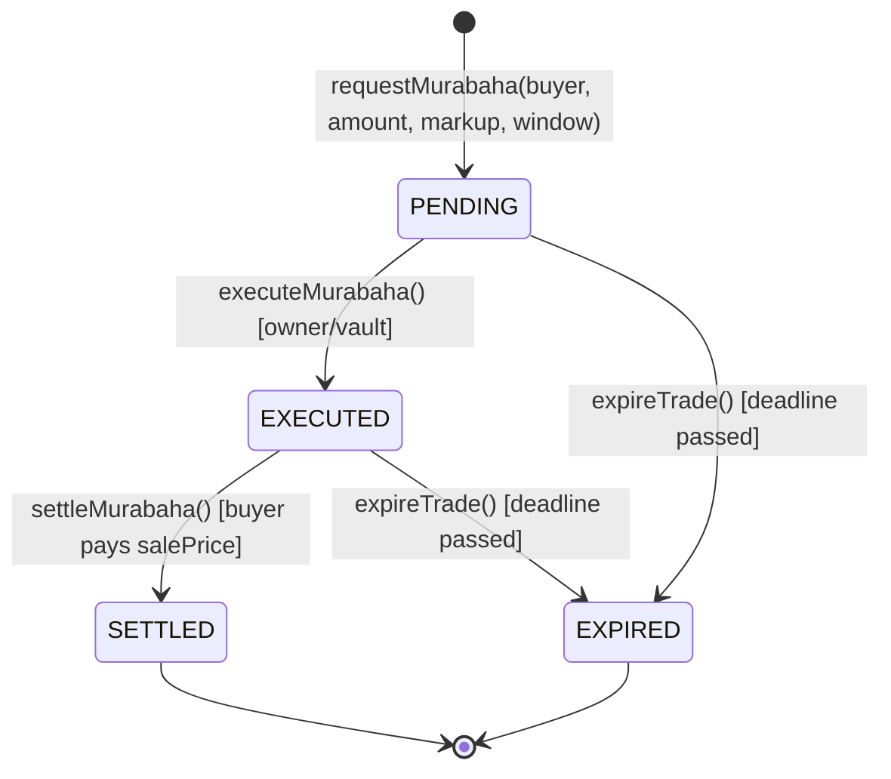
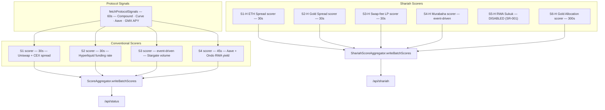
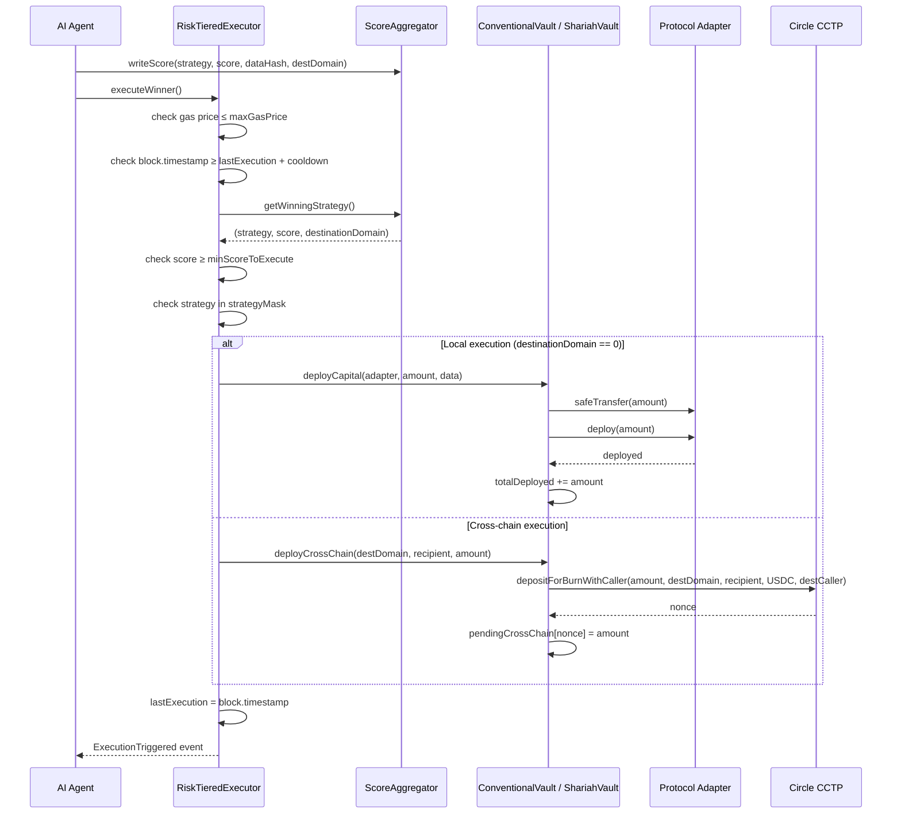
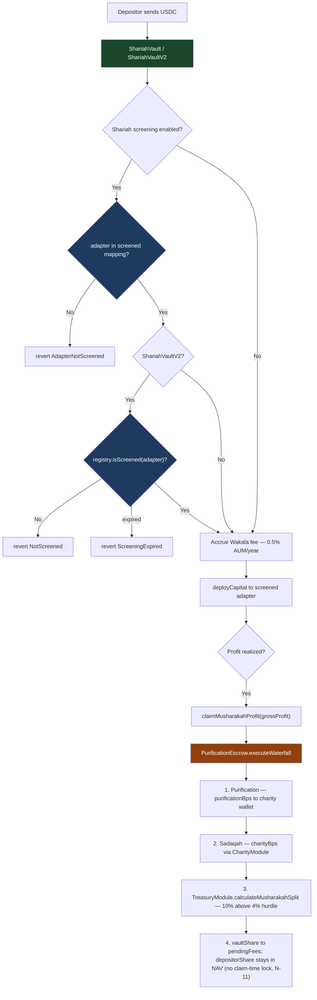
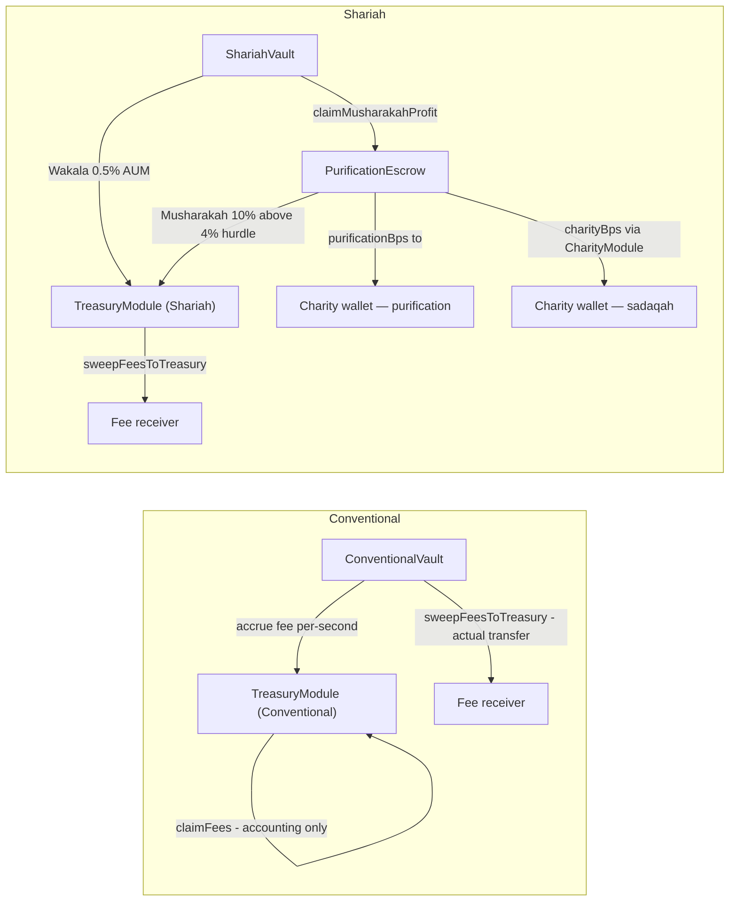
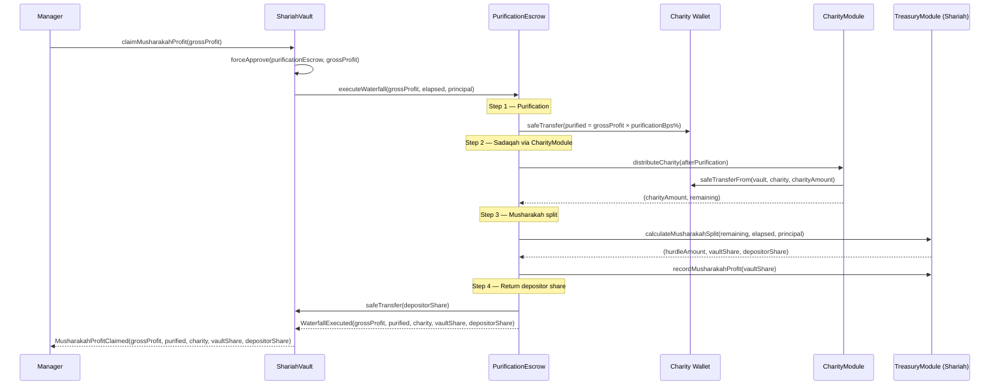

# DeFiVault Finance

**Autonomous, AI-powered DeFi capital allocation on Arc Testnet**  
Live at [defivault.finance](https://defivault.finance) · USDC-native

DeFiVault is an ERC-4626 vault protocol with four risk tiers across two communities — Conventional and Shariah. An on-chain AI agent continuously scores strategies, routes capital through protocol adapters, and executes the winning strategy on every cycle. All fees are transparent and on-chain; Shariah vaults auto-route charitable contributions before any profit split.

**Latest (2026-10-31):** Tasks M and N and the security-review fixes (N-01 to N-36, see `docs/security-review.md`) are in. Highlights since Task L: no claim-time profit lock in the Shariah vault (N-11); a per-share high-water mark (N-21); net-of-cut pricing with exit settlement (N-29); non-gold mark-to-market with a deposit gate (N-27); a two-sided, TWAP-priced `HalalLPAdapter` (N-05), now tested against the real Uniswap V3 USDC/EURC pool on an Arc mainnet fork, which led to N-33 (adapter read gas) and N-34 (deposit gate vs LP entry cost); `returnCapital` restricted to funded adapters (N-35). `forge test`: 2074 passed, 0 failed, 4 skipped (fork suites without an RPC). `ShariahVaultV2` runtime 24,317 B of 24,576. Testnet only; mainnet is not approved (see `workplan.md`).

**Revision history (Tasks A–L, Oct 2026):** Phases 2 and 3 complete (Tasks A–L). **N1:** the gold cross-chain guard is per strategy (S2-H and S6-H are never routed cross-chain); the old all-or-nothing `goldCrossChainBlocked` flag is removed (SR-023 superseded). **N2:** `dustThreshold` has a hard cap and a board-gated 30-day timelock. **N3:** `SHARIAH_REVIEW.md` restructured; SR-024 to SR-027 added. OUSG/BUIDL removed from Shariah tier (SR-001); gold exchanges enforced as atomic single-transaction swaps for yad bi yad compliance (S2-H); S6-H XAUT Gold Allocation adapter with Chainlink oracle, pool deviation guard, and 30-day timelock on all board-settable parameters; combined gold cap 30%; `currentValue()` never reverts — stale oracle falls back to `lastGoodPrice × (1 − staleHaircutBps)` (PR1 / I2 applied to both S2-H and S6-H). PurificationEscrow rate requires board propose + 30-day timelock (PR2). High-water mark loss carry-forward; profit unlock streaming (3-day default); cross-chain pending cap (20% default). **J1:** cross-chain settle replaced with `settleCrossChainWithMessage(nonce, message, attestation)` — atomic CCTP V2 message reception with balance-delta verification; old `settleCrossChain(nonce, 0)` demoted to owner-only write-off path (SR-019). **J2:** deposit pause only when gold adapter holds material position (`currentValue > dustThreshold`); S2-H uses XAU/USD oracle for freshness — oracle is mandatory at construction since K2 (SR-020). **J3:** `CharityModule` and `PurificationEscrow` revert `RegistryRequired()` when constructed without a registry — address(0) fallback removed (SR-021). **J4:** six protocol invariants machine-verified (256 runs × depth 50; SR-022). **K1:** `settleCrossChainWithMessage` decodes `feeExecuted` from CCTP V2 BurnMessageV2 (228-byte fixed body; `feeExecuted` at body offset 164..195, `maxFee` at 132..163 — L1 corrected K1's wrong offset); `expectedNet = amount − feeExecuted`; fee emitted as `CrossChainFeeDeducted`; three new tests (fee=0, fee>0, fee+strategy-loss). **K2:** `GoldExchangeAdapter` oracle (`goldOracle`) is now mandatory at construction — `OracleRequired` revert when address(0); last-swap-age fallback removed from `isPriceSane()`; `CharityModule` `onlyBoardOrOwner` modifier renamed to `onlyBoard` — owner alone cannot propose or confirm unless also a registered board member. **PR2:** invariant suite expanded to 8 invariants and 17 handler actions: added `deployCrossChainAction`, `settleWithFee`, `settleShortfall`, `writeOff`, `lossRecall`, `dropGoldPrice`, `makeOracleStale`, `refreshOracle`, `moveOraclePrice`; Invariant 4 rephrased as no-dilution (share value CAN fall from oracle/shortfall/fee, but no depositor is diluted by another depositor's deposit or redemption); Invariant 7 (`totalPendingCrossChain == sum of open pendingCrossChain[nonce]`); Invariant 8 (cross-chain cap never exceeded). **PR3:** README synced — class diagram `settleCrossChain` sig, cross-chain flow diagram (J1 atomic path), adapter table S2-H row (oracle mandatory), security model cross-chain NAV row (K1 feeExecuted), CharityModule `onlyBoard` note. **PR4:** `contracts/script/Rehearsal.s.sol` — 8-step testnet rehearsal script (deploy, deposits, board screening with short-timelock testnet-only subclass, agent wiring, cross-chain round-trip, stale oracle confirmation, profit claim, full redemption); `docs/rehearsal.md` — run log template and open items. Single-source board role: `CharityModule` and `PurificationEscrow` delegate board membership to `ShariahAdapterRegistry.isBoard()` (I4); registry constructor separates owner from initial board member (I5). SR-G6 renumbered SR-012. **L1:** `CctpMessageDecoder` offset corrected — `feeExecuted` was being read from body[132..163] (`maxFee`) instead of body[164..195] (actual fee); `MIN_MESSAGE_LEN` raised to 344 (116+228); all four message builders updated; two new tests added (body-too-short revert; golden fixture that places distinct `maxFee` and `feeExecuted` values and confirms NAV drops by `feeExecuted`, not `maxFee`). **L2:** test-count audit — 398 non-invariant tests confirmed present across 34 files; README figure of 353 was a documentation error from the K session; no tests were deleted. **L3:** J2 S2-H oracle note corrected (mandatory since K2); K1 body description corrected (228-byte body, offset 164..195); invariant command note added (`foundry.toml` `[profile.default.invariant]` owns runs=256 depth=50). 398 non-invariant tests + 8 invariants green. Open board review items SR-001 to SR-027 (none yet approved; SR-015, SR-017 and SR-023 are superseded) in `docs/agents/SHARIAH_REVIEW.md`.

---

## Table of Contents

1. [Architecture Overview](#architecture-overview)
2. [Vault Tiers](#vault-tiers)
3. [Contract Hierarchy](#contract-hierarchy)
4. [Core Contracts](#core-contracts)
5. [Strategy Adapters](#strategy-adapters)
6. [Agent Scoring System](#agent-scoring-system)
7. [Execution Workflow](#execution-workflow)
8. [Cross-Chain Flow](#cross-chain-flow)
9. [Shariah Compliance Workflow](#shariah-compliance-workflow)
10. [Fee Architecture](#fee-architecture)
11. [Charitable Contribution Waterfall](#charitable-contribution-waterfall)
12. [Security Model](#security-model)
13. [Test Coverage](#test-coverage)
14. [Deployment](#deployment)

---

## Architecture Overview

```mermaid
graph TB
    subgraph UI ["DeFiVault Frontend (React + Vite)"]
        LP[Landing Page]
        VP[Vault Picker]
        SP[Strategies Page]
        DP[Dashboard]
    end

    subgraph Agent ["AI Agent Server (Express)"]
        SA[Strategy Scorers]
        SS[Shariah Scorers]
        CP[CCTP Attestation Poller]
        SC_ENG[Screening Engine — 11 SC-SAC rules]
        AC["API: /api/status · /api/shariah · /api/screening · /api/charity · /api/apy"]
    end

    subgraph Conventional ["Conventional Vaults"]
        CV_P[ConventionalVault · Passive]
        CV_A[ConventionalVault · Aggressive]
        RTE_P[RiskTieredExecutor · PASSIVE]
        RTE_A[RiskTieredExecutor · AGGRESSIVE]
        AGG[ScoreAggregator]
        CT[TreasuryModule · Conventional]
    end

    subgraph Shariah ["Shariah Vaults"]
        SV_C[ShariahVault · Conservative]
        SV_D[ShariahVault · Dynamic]
        SV_V2[ShariahVaultV2 · Registry-gated]
        RTE_SC[RiskTieredExecutor · SHARIAH_CONSERVATIVE]
        RTE_SD[RiskTieredExecutor · SHARIAH_DYNAMIC]
        SAGG[ShariahScoreAggregator]
        ST[TreasuryModule · Shariah]
        ZM["ZakatModule (deprecated — v1 compat)"]
        CM[CharityModule]
        PE[PurificationEscrow]
        REG[ShariahAdapterRegistry]
    end

    subgraph Adapters ["Protocol Adapters"]
        COMP[CompoundAdapter]
        CURVE[CurveAdapter]
        AAVE[AaveLoopAdapter]
        GMX[GmxAdapter]
        HLP[HalalLPAdapter]
        MUR[CommodityMurabahaAdapter]
        GEA[GoldExchangeAdapter S2-H]
        GAA[GoldAllocationAdapter S6-H]
        RWA["RwaYieldAdapter (deprecated SR-001)"]
    end

    CCTP[Circle CCTP · TokenMessengerV2]

    UI --> Agent
    SA --> AGG
    SS --> SAGG
    RTE_P --> CV_P
    RTE_A --> CV_A
    RTE_SC --> SV_C
    RTE_SD --> SV_D
    CV_P --> CT
    CV_A --> CT
    SV_C --> ST
    SV_C -.->|v1 compat| ZM
    SV_D --> ST
    SV_D -.->|v1 compat| ZM
    SV_C --> PE
    SV_D --> PE
    SV_V2 --> REG
    SV_V2 --> PE
    PE --> CM
    PE --> ST
    SC_ENG --> REG
    CV_P --> COMP
    CV_P --> CURVE
    CV_A --> AAVE
    CV_A --> GMX
    SV_C --> HLP
    SV_C --> GEA
    SV_C --> GAA
    SV_D --> HLP
    SV_D --> MUR
    SV_D --> GEA
    SV_D --> GAA
    CV_P --> CCTP
    CV_A --> CCTP
    SV_C --> CCTP
    SV_D --> CCTP
```



---

## Vault Tiers

| Tier | Type | Strategies | Min Score | Cooldown | Fee Model |
|---|---|---|---|---|---|
| **Passive** | Conventional | S1 Cross-chain Spread, S4 RWA Yield | 80 | 2h | 0.75% AUM |
| **Aggressive** | Conventional | S1–S4 all | 60 | 30m | 0.75% AUM |
| **Conservative** | Shariah | S2-H Gold Spread, S3-H Swap-fee LP, S6-H Gold Allocation | 80 | 2h | 0.5% Wakala |
| **Dynamic** | Shariah | S1-H through S4-H + S6-H (S5-H retired) | 70 | 1h | 0.5% Wakala + 10% Musharakah |

Each tier is a separate vault deployment (independent NAV, independent share token) — capital from one tier never mixes with another.

---

## Contract Hierarchy



---

## Core Contracts

### `AutonomousVault.sol`

Base ERC-4626 vault. All four tier vaults inherit this.

| Feature | Detail |
|---|---|
| Asset | USDC (6 decimals) |
| Share decimals offset | +6 (12 total) — inflation-attack protection |
| Max allocation cap | 80% of `totalAssets()` by default (configurable up to 95%) |
| Manager role | Single address that can call `deployCapital` and `deployCrossChain` |
| CCTP | Immutable `sourceDomain` set at construction; `tokenMessenger` configurable |
| Cross-chain accounting | `pendingCrossChain[nonce]` tracks outbound capital until `settleCrossChain`; shortfall booked as immediate NAV loss |
| Cross-chain cap | `maxPendingCrossChainBps` (default 20%) caps total in-flight USDC; `deployCrossChain` reverts `PendingCrossChainCapExceeded` if breached |
| Profit unlock | `lockedProfit` streams into `totalAssets()` linearly over `profitUnlockPeriod` (default 3 days, max 14 days); flash-claim-redeem earns ~0 |

Key functions:

```solidity
function deployCapital(address strategy, uint256 amount, bytes calldata data) public virtual
function deployCrossChain(uint32 destDomain, bytes32 recipient, uint256 amount) external
function returnCapital(address strategy, uint256 amount) external
function recallCapital(address adapter, uint256 amount) external
// Atomic settle (J1): decodes feeExecuted from message, mints via MessageTransmitter, verifies delta
function settleCrossChainWithMessage(uint64 nonce, bytes calldata message, bytes calldata attestation) external
// Write-off only (J1, owner): books full loss when USDC is unrecoverable; received must be 0
function settleCrossChain(uint64 nonce, uint256 received) external
```

### `ConventionalVault.sol`

Inherits `AutonomousVault`. Adds admin fee accrual (0.75% AUM, pro-rated per second).

### `ShariahVault.sol`

Inherits `AutonomousVault`. Overrides `deployCapital` to enforce:
1. Adapter must be in `screened` mapping
2. Asset must be in `permittedAssets` mapping (USDC, ETH, PAXG — OUSG and BUIDL removed per SR-001)
3. Wakala fee accrued on every deployment
4. Combined gold cap: `goldSpreadAdapter.currentValue() + goldAllocationAdapter.currentValue() <= MAX_GOLD_BPS * totalAssets() / 10_000`

`claimMusharakahProfit(grossProfit)` delegates to `purificationEscrow.executeWaterfall()` — reverts `PurificationEscrowNotSet` if escrow not wired. There is no claim-time profit lock (removed in N-11): NAV is already priced net of the pending distribution cut (N-29), so a claim does not move the share price and a deposit-claim-redeem gains nothing. The manager's discretionary `lockProfit` remains for yield recognized on recall or return. The split uses a per-share high-water mark (`highWaterMarkPerShare`, N-21), so the vault earns zero until the realized share price is back above its previous high. `MusharakahProfitClaimed` event emits 5 params: `(grossProfit, purified, charity, vaultShare, depositorShare)`.

`maxDeposit`/`maxMint` are overridden to return 0 when either `goldSpreadAdapter.isPriceSane()` or `goldAllocationAdapter.isPriceSane()` is false — new deposits are blocked while either gold adapter is stale (I2); redemptions remain open at all times.

### `ShariahVaultV2.sol`

Inherits `ShariahVault`. Adds on-chain governance via `ShariahAdapterRegistry`. Overrides `deployCapital` to check `registry.isScreened(strategy)` before the inherited checks — reverts `NotScreened` when `pronouncementHash == 0`, reverts `ScreeningExpired` when `block.timestamp >= expiresAt`. V1 vaults remain live; no forced migration.

### `ShariahAdapterRegistry.sol`

Governance-gated adapter registry. Board members may propose and execute screening changes with a 30-day timelock. Board membership itself requires a board-member co-proposal plus 30-day timelock (`proposeBoardRoleChange` / `executeBoardRoleChange`); the owner retains only `emergencyRevokeBoardRole` (instant removal only — cannot grant without the board, G4). Each screening entry records a `pronouncementHash` (bytes32) and `expiresAt` (uint256 timestamp). `isScreened(adapter)` returns true only when both are non-zero and not expired. `MAX_EXPIRY_PERIOD = 730 days`.

### `CharityModule.sol`

Routes charitable contributions (sadaqah) from Shariah gross profit to the board-designated charity wallet. Default rate: `charityBps = 250` (2.5%), hard cap `MAX_CHARITY_BPS = 500` (5%). Both wallet address and rate require a 30-day timelock to change via `onlyBoard` functions. `boardRegistry` is mandatory (J3) and board membership is always resolved from `ShariahAdapterRegistry.isBoard()` — the owner alone CANNOT propose or confirm unless they are also a board member (K2 rename: `onlyBoardOrOwner` → `onlyBoard`). Only the bound vault (or PurificationEscrow) can call `distributeCharity`.

### `PurificationEscrow.sol`

Enforces the four-step Shariah profit waterfall on every `claimMusharakahProfit` call:
1. **Purification** — `purificationBps` of gross profit sent directly to CharityModule's charity wallet
2. **Sadaqah** — `charityBps` of the remaining profit routed via CharityModule
3. **Musharakah split** — remaining divided by TreasuryModule (10% vault share above 4% hurdle)
4. **Depositor return** — depositor share transferred back to vault

When `boardRegistry` is set (immutable at deploy), `onlyBoard` for `proposePurificationRate`/`confirmPurificationRate`/`cancelPurificationRate` delegates to `ShariahAdapterRegistry.isBoard()` (I4) — a single registry board change propagates to both `CharityModule` and `PurificationEscrow` simultaneously.

Invariant proven by fuzz: `purified + charity + vaultShare + depositorShare == grossProfit` (512 runs).

### `RiskTieredExecutor.sol`

One instance per vault tier. Reads the winning strategy from the aggregator and routes execution.



Tier parameters:

| Tier | `minScoreToExecute` | `executionCooldown` | `maxGasPrice` | `strategyMask` |
|---|---|---|---|---|
| PASSIVE | 80 | 2h | 20 gwei | `9` — `0b001001` (bits 0+3) |
| AGGRESSIVE | 60 | 30m | 50 gwei | `15` — `0b001111` (bits 0–3) |
| SHARIAH_CONSERVATIVE | 80 | 2h | 30 gwei | `38` — `0b100110` (bits 1+2+5) |
| SHARIAH_DYNAMIC | 70 | 1h | 30 gwei | `47` — `0b101111` (bits 0–3+5) |

### `ScoreAggregator.sol`

Stores scores for 4 conventional strategies. Ring-buffer of 10 history slots per strategy. 5-minute staleness guard.

```solidity
enum Strategy {
    STABLECOIN_SPREAD,    // S1 — USDC/USDT cross-chain
    FUNDING_RATE_ARB,     // S2 — Hyperliquid perp funding
    BRIDGE_FLOW,          // S3 — Stargate bridge flow
    LIQUIDATION_RWA       // S4 — Aave liquidation + Ondo RWA
}
```

### `ShariahScoreAggregator.sol`

Parallel aggregator for 6 Shariah strategies. Adds `strategyEnabled` bool per strategy (renamed from `shariahCertified` — "certified" is reserved for board rulings, G3) — only enabled strategies can win. Enum order is fixed (append-only); deprecated slots revert `StrategyDeprecated`.

```solidity
enum ShariahStrategy {
    ETH_SPREAD,       // 0  S1-H USDC/ETH cross-chain spread      — enabled (testnet); SR-007, SR-027 pending
    GOLD_SPREAD,      // 1  S2-H PAXG/USDC atomic swap             — enabled (testnet); SR-005 pending
    HALAL_LP,         // 2  S3-H Uniswap V3 swap-fee income        — enabled (testnet); SR-011 pending (contract file kept as HalalLPAdapter.sol — G9)
    MURABAHA,         // 3  S4-H Commodity Murabaha                 — enabled (testnet); SR-024 pending
    RESERVED_4,       // 4  S5-H (RWA/Sukuk) — DEPRECATED (SR-001); writeScore(4,...) reverts
    GOLD_ALLOCATION   // 5  S6-H XAUT spot position                 — disabled until SR-008 approved
}
```

### `TreasuryModule.sol`

Accounting-only fee ledger. Actual USDC transfer happens only when the vault calls `sweepFeesToTreasury`.

- **Conventional**: `adminFeeBps = 75` (0.75%), `musharakahShareBps = 0`
- **Shariah**: `adminFeeBps = 50` (0.5% Wakala), `musharakahShareBps = 1000` (10%), `hurdleRateBps = 400` (4%)

`claimFees` is accounting-only — it decrements `pendingFees` and emits the event; the caller must separately trigger `sweepFeesToTreasury` on the vault to move actual tokens. Fee sweeps are capped to `pendingFees` to prevent draining depositor principal.

`calculateMusharakahSplitHWM(grossProfit, elapsed, principal, hwmDeficit)` is the high-water mark variant: `vaultShare = 0` when `grossProfit < hwmDeficit`, ensuring the vault takes no profit during a loss-recovery period. Called by `ShariahVault.claimMusharakahProfit` when `hwmDeficit > 0`.

### `ZakatModule.sol`

**Deprecated for new deployments.** Kept live for v1 vault history and redemption continuity. Do not wire into new vaults — use `CharityModule` + `PurificationEscrow` instead. The fixed `ZAKAT_BPS = 250` (2.5%) rate and 30-day wallet timelock remain intact for v1 vault operations.

### `PositionTracker.sol`

Tracks open positions per vault, including cross-chain `destinationDomain`, PnL accounting, and position lifecycle (OPEN → CLOSED).

---

## Strategy Adapters

All adapters implement `IStrategyAdapter`:

```solidity
interface IStrategyAdapter {
    function deploy(uint256 amount) external returns (uint256 deployed);
    function recall(uint256 amount) external returns (uint256 returned);
    function currentValue() external view returns (uint256);
    function protocolName() external view returns (string memory);
    function vault() external view returns (address);
}
```

Only the vault can call `deploy` and `recall` (enforced by `onlyVault` modifier on every adapter).

| Adapter | Protocol | Tier(s) | Strategy | Status |
|---|---|---|---|---|
| `CompoundAdapter` | Compound V3 Comet | Passive | S1 | Active |
| `CurveAdapter` | Curve 3pool LP | Passive | S4 | Active |
| `AaveLoopAdapter` | Aave V3 2x leverage | Aggressive | S2 | Active |
| `GmxAdapter` | GMX V2 GLP | Aggressive | S3 | Active |
| `HalalLPAdapter` | Uniswap V3 two-sided LP (USDC + pair token, TWAP-priced) | Conservative + Dynamic | S3-H | Not deployed on testnet. Tested with mocks and on an Arc mainnet fork against the real USDC/EURC 0.05% pool (N-05, N-33, N-34). No executor strategy config in the rehearsal stack. SR-011 pending |
| `CommodityMurabahaAdapter` | Murabaha trade lifecycle | Dynamic | S4-H | Active |
| `GoldExchangeAdapter` | PAXG/USDC atomic swap (Uniswap V3) | Conservative + Dynamic | S2-H | Active; stale detection: XAU/USD oracle `updatedAt` age > `maxStalenessSecs` (1 day default) — oracle is now **mandatory** (K2, `OracleRequired` at construction). `isPriceSane()` false → deposits paused (dust-threshold gated, J2), `currentValue()` applies haircut (I2 / SR-016) |
| `GoldAllocationAdapter` | XAUT spot position (oracle + Uniswap V3) | Conservative + Dynamic | S6-H | Pending SR-008; stale oracle falls back to `lastGoodPrice × (1 − staleHaircutBps)` (PR1); `pokePrice()` permissionless; `recall()` never reverts (G1) |
| `RwaYieldAdapter` | OUSG / BUIDL direct hold | — | S5-H | Deprecated (SR-001); unscreened from Shariah tier |

### `CommodityMurabahaAdapter` — Trade Lifecycle



- Max 50 concurrent active trades (DoS guard)
- O(1) removal via index mapping + swap-and-pop
- Buyer pays `costAmount + markup` directly to vault on settlement

---

## Agent Scoring System

The Express agent (`server/agent.ts`) runs continuously alongside the frontend. Each strategy has its own scorer with a configurable interval.



All agent intervals and thresholds are hot-reloadable via `POST /api/config`.

---

## Execution Workflow



---

## Cross-Chain Flow

```mermaid
sequenceDiagram
    participant Vault as Source Vault (Arc)
    participant CCTP as Circle CCTP
    participant Dest as Destination Chain
    participant Agent as AI Agent
    participant Owner as Manager / Owner

    Note over Vault,CCTP: Outbound — deploy capital cross-chain
    Vault->>CCTP: depositForBurnWithCaller(amount, destDomain, recipient, USDC, caller)
    CCTP-->>Vault: nonce
    Vault->>Vault: pendingCrossChain[nonce] = amount
    Vault->>Vault: totalDeployed += amount

    Note over Agent,CCTP: Agent polls for CCTP attestation
    Agent->>CCTP: GET /v1/attestations/{messageHash}
    CCTP-->>Agent: {status: "complete", attestation: "..."}

    Note over Dest,Owner: Strategy executes on destination
    Dest->>Dest: capital deployed to protocol

    Note over Owner,Vault: Inbound — atomic settle (J1)
    Owner->>Vault: settleCrossChainWithMessage(nonce, message, attestation)
    Vault->>Vault: decode mintRecipient, amount, feeExecuted from message
    Vault->>Vault: revert WrongMintRecipient if recipient != vault
    Vault->>CCTP: MessageTransmitter.receiveMessage(message, attestation)
    CCTP-->>Vault: mints (amount − feeExecuted) USDC
    Vault->>Vault: require balanceDelta == amount − feeExecuted (MessageAmountMismatch guard)
    Vault->>Vault: totalDeployed -= pendingCrossChain[nonce]; shortfall absorbed into NAV
    Vault->>Vault: totalPendingCrossChain -= pendingCrossChain[nonce]
    Vault->>Vault: delete pendingCrossChain[nonce]
    Vault-->>Owner: CrossChainFeeDeducted(nonce, feeExecuted) [if fee > 0]
    Vault-->>Owner: CrossChainSettled(nonce, received, shortfall)

    Note over Owner,Vault: Write-off path (owner only, USDC unrecoverable)
    Owner->>Vault: settleCrossChain(nonce, 0)
    Vault->>Vault: book full loss; delete pendingCrossChain[nonce]
```

---

## Shariah Compliance Workflow



**Permitted Shariah assets:** USDC, ETH, PAXG — OUSG and BUIDL removed per SR-001  
**XAUT:** S6-H adapter written; `strategyEnabled[5]` is `false` until SR-008 accepted by the board  
**Prohibited actions:** Aave lending (riba), perp funding payments, front-running MEV, non-atomic gold transfers across chain boundaries (gold strategies S2-H and S6-H are never routed cross-chain; plain USDC transfers are not blocked)  
**V2 registry requirement:** `pronouncementHash != 0` AND `block.timestamp < expiresAt` — board must execute screening with the hash of the protocol's Shariah board pronouncement before any adapter is usable in V2 (SC-SAC resolutions are cited as rule sources in `shariah-rules.yaml`; per-adapter approvals come from the vault's own Shariah board)

---

## Fee Architecture



| Fee | Rate | Mechanism | When |
|---|---|---|---|
| Admin fee (Conventional) | 0.75% AUM / year | Pro-rated per second, accounting-only | On every `deployCapital` |
| Wakala fee (Shariah) | 0.5% AUM / year | Pro-rated per second | On every Shariah `deployCapital` |
| Musharakah profit share | 10% of profit above 4% hurdle | Applied via PurificationEscrow on `claimMusharakahProfit` | When manager claims |
| Purification (disposal of non-compliant income) | Board-set `purificationBps` (default 0; max 10%) | Step 1 of waterfall; sent directly to charity wallet | Before any Musharakah split |
| Charitable contribution (sadaqah) | Board-set `charityBps` (default 2.5%; max 5%) | Step 2 of waterfall; routed via CharityModule | After purification, before split; **30-day timelock** via `proposeCharityRateChange` |
| Purification rate setter | `PurificationEscrow.proposePurificationRate` → `confirmPurificationRate` (default 0%; max 10%) | `onlyBoard`, 30-day timelock (PR2 / SR-012) | Full timelock; symmetric with charityBps governance |

---

## Charitable Contribution Waterfall

The four-step waterfall is enforced by `PurificationEscrow.executeWaterfall()` on every `claimMusharakahProfit` call. The fuzz invariant `purified + charity + vaultShare + depositorShare == grossProfit` is proven at 512 runs.



**All profit waterfall rate and wallet changes require a 30-day timelock:**

```
CharityModule.proposeCharityWalletChange(newWallet)  →  wait 30 days  →  confirmCharityWalletChange()
CharityModule.proposeCharityRateChange(newBps)        →  wait 30 days  →  confirmCharityRateChange()
PurificationEscrow.proposePurificationRate(newBps)    →  wait 30 days  →  confirmPurificationRate()
```

All three are `onlyBoard` (resolved via `ShariahAdapterRegistry.isBoard()` when `boardRegistry` is set, I4). Board membership changes on the registry propagate instantly to both contracts — there is one source of truth. `ShariahAdapterRegistry` constructor now accepts a separate `initialBoardMember` arg; the owner does NOT automatically receive boardRole (I5). Governance is now fully symmetric — see SR-012 and SR-018 in `SHARIAH_REVIEW.md`.

The deprecated `ZakatModule` remains deployed for v1 vault compatibility and is not wired into any new vault. V1 redemptions remain available at NAV with no forced migration.

---

## Security Model

| Threat | Mitigation |
|---|---|
| Inflation attack | `_decimalsOffset = 6` on all vaults (shares have 12 decimals, USDC has 6) |
| Principal drain via fee sweep | `sweepFeesToTreasury` capped to `TreasuryModule.pendingFees` |
| Shariah screening bypass | `deployCapital` overridden in `ShariahVault`; base function is `virtual` |
| Unlimited trade DoS | `CommodityMurabahaAdapter` enforces `MAX_ACTIVE_TRADES = 50` |
| O(n) removal DoS | Active trade removal uses index mapping + swap-and-pop (O(1)) |
| Over-allocation | `maxAllocationBps` cumulative cap (default 80%) enforced on every deployment |
| Stale oracle execution | 5-minute staleness guard in both score aggregators |
| Gas price manipulation | `maxGasPrice` guard per tier in `RiskTieredExecutor` |
| Cross-chain double-settle | `settleCrossChainWithMessage` / `settleCrossChain` both delete `pendingCrossChain[nonce]` atomically on first use; nonce can never be settled twice (J1) |
| Same-domain CCTP loop | `deployCrossChain` reverts `SameDomainDeploy` if `destDomain == sourceDomain` |
| Charitable wallet rug | 30-day timelock on all `CharityModule` wallet + rate changes; `ZakatModule` also timelocked for v1 compat |
| RWA lending exposure | `RwaYieldAdapter` has no approve-for-lending function by design |
| Unscreened adapter in V2 | `ShariahAdapterRegistry.isScreened` checks hash non-zero AND expiry; board + 30-day timelock to screen |
| Screening expiry bypass | `ScreeningExpired` revert when `block.timestamp >= expiresAt`; max expiry 730 days enforced at proposal |
| Combined deduction drain | `MAX_COMBINED_DEDUCTION_BPS = 5000`; PurificationEscrow reverts if purification + charity would exceed 50% |
| Gold cap breach | `ShariahVault.deployCapital` sums `goldSpreadAdapter.currentValue() + goldAllocationAdapter.currentValue()` and reverts `GoldCapExceeded` when combined > `MAX_GOLD_BPS` (30%) |
| Non-atomic gold cross-chain | Per strategy (Task N1): `ShariahVault.deployCrossChainForStrategy` reverts `NonAtomicGoldExchange` for GOLD_SPREAD and GOLD_ALLOCATION, and the Shariah executor reverts it when a gold winner reports a non-zero destination domain. Plain USDC cross-chain deploys are not blocked by held gold (SR-023 superseded) |
| Stale Chainlink gold price | `GoldAllocationAdapter._getOraclePrice` checks `startedAt > 0`, `answeredInRound >= roundId`, `answer > 0`, and `block.timestamp - updatedAt <= maxStalenessSecs` |
| Pool-oracle gold deviation (deploy) | `GoldAllocationAdapter.deploy()` checks `isPriceSane()` first; reverts `OracleNotSane` if oracle is stale or pool price deviates beyond `maxDeviationBps`. New gold buys are blocked; existing positions are unaffected. |
| Stale oracle gold valuation | `GoldAllocationAdapter.currentValue()` never returns cost basis. Sane oracle: valued at the oracle price only (the pool price is used for execution sanity, never for valuation). Stale oracle: `lastGoodPrice × (1 − staleHaircutBps)` where `staleHaircutBps` defaults to 500 (5%), capped at 2000 (20%), board-settable via 30-day timelock (PR1 / SR-013). `lastGoodPrice` updated on every successful oracle read; `pokePrice()` is permissionless. `vault.redeem()` always succeeds — pool reads are try/catch. |
| Stale oracle deposit block | `ShariahVault.maxDeposit`/`maxMint` return 0 when either gold adapter is stale AND the adapter's funded principal exceeds the effective dust threshold (default 1 USDC; hard-capped at `max(0.5% of totalAssets, 1 USDC)` and changeable only by a board proposal with a 30-day timelock, N2 / SR-020). A freshly-deployed adapter with no capital never blocks deposits. Redemptions remain open at all times (PR1 / J2). |
| Pool-oracle gold deviation (recall) | `GoldAllocationAdapter.recall()` uses `_getOraclePriceSafe()` — never reverts on stale oracle. A fresh oracle sets the sale floor and a deviating pool never lowers it (the swap reverts instead). During an oracle outage the floor is `lastGoodPrice` less the stale haircut and a bounded emergency slippage (default 10%, cap 25%, 30-day timelock). `vault.redeem()` stays available because redemption does not depend on the gold oracle (G1). |
| Parameter manipulation (gold adapter) | All numeric and address params on `GoldAllocationAdapter` require 30-day timelock via `proposeParamChange` / `executeParamChange`; hard caps enforced at proposal time |
| Reentrancy in executor | `RiskTieredExecutor.executeWinner` uses `_executionLocked` guard; `lastExecutionTime` set before external calls |
| Flash-claim-redeem profit extraction | Shariah vault: NAV is priced net of the pending distribution cut (N-29), so a claim leaves the share price unchanged and a deposit-claim-redeem extracts nothing. The claim-time lock was removed (N-11). Yield that enters NAV on recall or return is still visible instantly; the manager's `lockProfit` streams it over `profitUnlockPeriod` (default 3 days) when used |
| Loss carry-forward (Musharakah HWM) | `TreasuryModule.calculateMusharakahSplitHWM`: `vaultShare = 0` until cumulative losses (`hwmDeficit`) are recovered above `highWaterMark`; depositors bear losses pro-rata, vault takes no profit during recovery (PR3 / SR-004) |
| Cross-chain over-exposure | `deployCrossChain` reverts `PendingCrossChainCapExceeded` when `totalPendingCrossChain + amount > totalAssets() × maxPendingCrossChainBps / 10_000` (default cap 20%); cap enforced against pre-burn NAV (bug fix — previously checked post-burn) |
| Cross-chain NAV manipulation | J1/K1: `settleCrossChainWithMessage` decodes `amount` AND `feeExecuted` from the CCTP V2 message, calls `MessageTransmitter.receiveMessage` atomically, and reverts `MessageAmountMismatch` if balanceDelta != `amount − feeExecuted`. `feeExecuted > 0` for Fast Transfer; the fee is booked as a cost and emitted as `CrossChainFeeDeducted`. `WrongMintRecipient` prevents intercepted messages. Write-off path (`settleCrossChain(nonce, 0)`, owner-only) is the only way to book a zero-recovery loss (J1 / SR-019) |
| S2-H stale-price valuation | `GoldExchangeAdapter.currentValue()` now uses `lastGoodPrice` (set at each atomic swap) rather than `totalDeployed`. Stale detection: `block.timestamp − lastGoodPriceAt > maxStalenessSecs` (default 1 day, max 7 days). Stale: `grossValue × (1 − staleHaircutBps)`. `isPriceSane()` returns false when stale; `ShariahVault.maxDeposit/maxMint` return 0 when either gold adapter is not sane (I2 / SR-016) |
| Governance divergence (board membership) | `CharityModule` and `PurificationEscrow` both delegate board membership to `ShariahAdapterRegistry.isBoard()` via immutable `boardRegistry`. A single registry board change immediately propagates to both contracts. `ShariahAdapterRegistry` constructor now separates owner (emergency powers only) from `initialBoardMember` (receives boardRole — should be Safe multisig in production) (I4/I5 / SR-018) |
| Registry-free deploy | J3: both `CharityModule` and `PurificationEscrow` revert `RegistryRequired()` at construction when `boardRegistry = address(0)`. The address(0) local-fallback path is gone — every Shariah deploy must provide a live registry address (J3 / SR-021) |
| Empty-adapter deposit block | J2: `ShariahVault.maxDeposit/maxMint` block deposits only when a gold adapter is stale AND the adapter's funded principal exceeds the effective dust threshold (default 1 USDC; hard-capped at `max(0.5% of totalAssets, 1 USDC)` and changeable only by a board proposal with a 30-day timelock, N2 / SR-020). A freshly deployed adapter with no capital never blocks new deposits (J2 / SR-020) |
| Protocol invariants (machine-verified) | PR2 / J4: eight Foundry invariant properties — redeem safety, totalAssets accounting, gold cap, no-dilution (share value may fall from oracle/shortfall/fee but never from another user's deposit or redemption), HWM vaultShare, locked-profit decay, cross-chain pending-sum (`totalPendingCrossChain == sum of open nonces`), cross-chain cap (never exceeded) — verified at 256 runs x depth 50 with 17 handler actions (J4 / SR-022) |

---

## Test Coverage

**398 non-invariant Foundry tests** across **34 test files**; **8 invariant properties** (256 runs x depth 50); **48 bun tests** in `server/screening/tests/`. Counts from `forge test --summary` — never hand-edited (G11).

Run the invariant suite with:
```
forge test --match-path 'contracts/test/invariant/*'
```
`--invariant-runs` and `--invariant-depth` are not needed on the command line: `[profile.default.invariant]` in `foundry.toml` sets `runs = 256` and `depth = 50`.

New in Task H: `TaskHTest.t.sol` (26 tests) covering PR1 gold haircut, PR2 purification timelock, PR3.1 HWM, PR3.2 profit unlock, PR3.3 cross-chain cap.
New in Task I: 5 test files (`TaskITest.Base`, `I1`, `I2`, `I3`, `I4I5`) — 29 tests covering I1 settle verification, I2 S2-H stale pricing, I3 HWM excess rule, I4 single-source board role, I5 registry constructor.
New in Task J: `TaskITest.I1.t.sol` rewritten for J1 API (5 tests); `AutonomousVaultTest` + `TaskHTest` settle tests updated for J1 atomic path; 3 invariant files (`VaultInvariant.Base`, `VaultInvariant.Handler`, `VaultInvariant.t.sol`) with 6 invariant properties.
New in Task K: 3 new K1 fee tests in `TaskITest.I1.t.sol` (fee=0, fee>0, fee+strategy-loss); all 7 `GoldExchangeAdapter` construction sites updated for mandatory oracle arg (K2); invariant handler expanded to 17 actions and suite to 8 invariants (PR2); `VaultInvariant.t.sol` Invariant 4 rewritten as no-dilution, Invariants 7 and 8 added (cross-chain pending-sum, cross-chain cap).
New in Task L: L1 fixes `feeExecuted` offset — corrected from body[132..163] (`maxFee`) to body[164..195] (actual fee); `MIN_MESSAGE_LEN` raised to 344 (116+228); all 4 message builders updated; 2 new tests (body-too-short revert, golden fixture distinguishing `feeExecuted` from `maxFee`). L2 audit: 396 non-invariant tests confirmed present — the README figure of 353 was a documentation error; no tests were deleted. L3: J2 oracle note updated (mandatory since K2); invariant `foundry.toml` note added.

**Foundry test suite (`forge test --fuzz-runs 512`):**

| File | Tests | Type | Coverage |
|---|---|---|---|
| `AutonomousVaultTest.t.sol` | 17 | Unit | Deposit, redeem, deploy, cap, cross-chain, pause, inflation |
| `ScoreAggregatorTest.t.sol` | 13 | Unit | Write, batch, staleness, ring-buffer, access control |
| `RiskTieredExecutorTest.t.sol` | 12 | Unit | Execute, cooldown, gas guard, bitmask, tier params |
| `TreasuryModuleTest.t.sol` | 16 | Unit | Accrue, claim, Musharakah split, bps guards |
| `ZakatModuleTest.t.sol` | 12 | Unit | Distribute, timelock, propose/confirm/cancel |
| `CommodityMurabahaAdapterTest.t.sol` | 18 | Unit | Request, execute, settle, expire, DoS guard |
| `ShariahVaultTaskATest.t.sol` | 11 | Unit | StrategyDeprecated guard, mask values (38/47), OUSG recall script |
| `GoldExchangeAdapterTest.t.sol` | 31 | Unit | Atomic swap, slippage, cross-chain block, combined cap |
| `GoldAllocationAdapterTest.t.sol` | 37 | Unit | Oracle guards, OracleNotSane (G1), deviation, timelock params, combined cap |
| `CharityModuleTest.t.sol` | 20 | Unit | Distribute, wallet + rate timelock, cap enforcement |
| `PurificationEscrowTest.t.sol` | 15 | Unit | Waterfall invariant, steps 1–4, ShariahVault integration |
| `ShariahAdapterRegistryTest.t.sol` | 19 | Unit | Screening lifecycle, board-role timelock (G4), emergencyRevoke, all custom errors |
| `ShariahVaultV2Test.t.sol` | 9 | Unit | NotScreened / ScreeningExpired, V1 compat, zero-zakatModule (G10) |
| `TaskGTest.t.sol` | 19 | Unit + Fuzz | G1 recall-on-stale (6), G3 strategyEnabled (4), G4 board-role (8), G10 (1) |
| `FuzzAutonomousVault.t.sol` | 10 | Fuzz (512 runs) | Round-trip, multi-depositor fairness, cap at all amounts |
| `FuzzScoreAggregator.t.sol` | 9 | Fuzz (512 runs) | Winner invariant, ring-buffer, staleness, access control |
| `FuzzRiskTieredExecutor.t.sol` | 10 | Fuzz (512 runs) | Score/cooldown/gas guards at all param values |
| `FuzzTreasuryModule.t.sol` | 10 | Fuzz (512 runs) | Split invariant: vaultShare + depositorShare == grossProfit |
| `FuzzZakatModule.t.sol` | 9 | Fuzz (512 runs) | Charity amount exactly 2.5%, timelock boundary, accumulation |
| `FuzzCommodityMurabaha.t.sol` | 9 | Fuzz (512 runs) | Sale price math, O(1) removal, max-trade cap |
| `FuzzGoldExchangeAdapter.t.sol` | 13 | Fuzz (512 runs) | Round-trip value, no PAXG stranded, cap invariant |
| `FuzzGoldAllocationAdapter.t.sol` | 5 | Fuzz (512 runs) | `currentValue()` precision, round-trip, gold cap invariant, timelock |
| `FuzzCharityModule.t.sol` | 6 | Fuzz (512 runs) | Arithmetic exactness, cap, timelock boundary, accumulator monotonicity |
| `FuzzPurificationEscrow.t.sol` | 4 | Fuzz (512 runs) | Waterfall invariant, zero-purification, charity proportionality |
| `FuzzShariahVaultV2.t.sol` | 4 | Fuzz (512 runs) | Migration round-trip NAV, timelock, screening expiry lifecycle, allocation cap |
| `TaskHTest.t.sol` | 26 | Unit + Fuzz | PR1 gold haircut (11), PR2 purification timelock (5), PR3.1 HWM (3), PR3.2 profit unlock (3), PR3.3 cross-chain cap + shortfall (4) |
| `TaskITest.I1.t.sol` | 10 | Unit | J1+K1+L1: atomic settle (exact, wrong recipient, mismatch, replay, write-off), K1 fee tests (fee=0, fee>0, fee+loss), L1 body-too-short revert, L1 golden fixture (`feeExecuted` vs `maxFee` offset) |
| `TaskITest.I2.t.sol` | 10 | Unit + Fuzz | I2 GoldExchangeAdapter stale-price valuation, isPriceSane, maxDeposit/maxMint block when S2-H stale |
| `TaskITest.I3.t.sol` | 5 | Unit + Fuzz | I3 HWM excess split: vaultShare on afterRecovery only, hurdle on excess, fuzz invariant |
| `TaskITest.I4I5.t.sol` | 9 | Unit | I4 single-source board (CharityModule + PurificationEscrow read registry), I5 owner≠board constructor |
| `VaultInvariant.t.sol` | 8 | Invariant (256x50, 17 handler actions) | redeem safety, totalAssets accounting, gold cap, no-dilution (share may fall from oracle/shortfall/fee, not from other users), HWM vaultShare, locked-profit decay, cross-chain pending-sum, cross-chain cap |

**Bun screening tests (`bun test server/screening/tests/`):**

48 tests covering all 11 SC-SAC rules, RS-002 three-zone boundary (0.0499/0.05/0.051), missing data → REVIEW, verdict priority combiner, known protocol fixtures (Aave FAIL / OUSG FAIL / UniV3 PASS / PAXG REVIEW with missing ratio data (G8) / PAXG PASS with full data / Hyperliquid FAIL), and determinism guarantee.

Run the full Foundry suite:

```bash
forge test --fuzz-runs 512
```

Run the screening engine bun tests:

```bash
bun test server/screening/tests/
```

Run a single Foundry file:

```bash
forge test --match-path contracts/test/AutonomousVaultTest.t.sol -vv
```

---

## Deployment

All contracts deploy to **Arc Testnet** (chain ID 5042002) with USDC as the native gas token.

**Deploy order (respects dependency graph):**

```
1.  TreasuryModule (Conventional)                  — no deps
2.  TreasuryModule (Shariah)                       — no deps
3.  ZakatModule × 2                                — no deps (one per v1 vault; deprecated — V2 passes address(0))
4.  ScoreAggregator                                — no deps
5.  ShariahScoreAggregator (6-strategy)            — no deps   [script: RedeployShariahAggregator.s.sol]
6.  ConventionalVault (Passive)                    — needs TreasuryModule
7.  ConventionalVault (Aggressive)                 — needs TreasuryModule
8.  ShariahVault (Conservative)                    — needs TreasuryModule + ZakatModule
9.  ShariahVault (Dynamic)                         — needs TreasuryModule + ZakatModule
10. RiskTieredExecutor × 4                         — needs vault + aggregator (masks: 9 / 15 / 38 / 47)
11. Adapters × 7 (conventional + Shariah-screened)  — needs vault address
12. GoldExchangeAdapter (S2-H)                     — needs vault + MockAllocatedGold pool
13. GoldAllocationAdapter (S6-H)                   — needs vault + MockXAUT + oracle + pool [script: DeployGoldAllocation.s.sol]
14. setManager(executor) on each vault             — wires executor as manager
15. setStrategyConfig per adapter                  — configures each adapter per tier
16. setGoldSpreadAdapter / setGoldAllocationAdapter on ShariahVault
17. setEnabled(0..3, true) — testnet only; on any production chain a non-zero board pronouncement hash is required first; indices 4 and 5 remain false (SR-001 and SR-008 open)
18. CharityModule                                  — needs asset + charityWallet + vault + registry address (I4); registry arg sets immutable `boardRegistry` so board changes propagate automatically [script: DeployShariahV2.s.sol]
19. PurificationEscrow                             — needs asset + charityModule + shariahTreasury + registry address (I4)
20. setPurificationEscrow on ShariahVault (Conservative + Dynamic)
21. ShariahAdapterRegistry                         — constructor takes `(initialOwner, initialBoardMember)`; pass the Safe multisig as `initialBoardMember`; deployer (owner) does NOT receive boardRole automatically (I5); `DeployShariahV2.s.sol` reads `BOARD_MULTISIG` env var, falls back to deployer on testnet
22. ShariahVaultV2 (Conservative + Dynamic)        — needs TreasuryModule + ZakatModule(address(0)) + registry [script: DeployShariahV2.s.sol]
23. RiskTieredExecutor × 2 for V2                  — same masks (38 / 47) pointing at V2 vault addresses; without these the agent cannot autonomously deploy into V2
24. board: proposeScreening per adapter            — wait 30 days → executeScreening (one per adapter per vault)
25. setRegistry on ShariahVaultV2 if registry rotated — owner-only; 30-day timelock for re-screening
```

**Constructor args quick reference:**

```solidity
// TreasuryModule
constructor(
    "Conventional",         // treasuryType
    address(conventionalVault),  // feeSource
    address(USDC),          // asset
    75,                     // adminFeeBps (0.75%)
    0,                      // musharakahShareBps
    0,                      // hurdleRateBps
    owner                   // initialOwner
)

// ShariahVault
constructor(
    IERC20(USDC),
    owner,
    26,                     // sourceDomain (Arc Testnet CCTP domain)
    address(shariahTreasury),
    address(zakatModule)
)

// RiskTieredExecutor (PASSIVE)
constructor(
    address(passiveVault),
    address(scoreAggregator),
    RiskTier.PASSIVE,
    owner
)
```

**Key addresses (Arc Testnet):**

| Contract | Address |
|---|---|
| USDC (ERC-20, Arc Testnet) | `0x3600000000000000000000000000000000000000` |
| CCTP TokenMessengerV2 | `0x8FE6B999Dc680CcFDD5Bf7EB0974218be2542DAA` |
| Arc Testnet CCTP source domain | `26` |
| XAUT (mainnet reference only) | `0x68749665FF8D2d112Fa859AA293F07A622782F38` — not deployed on Arc Testnet; use MockXAUT for tests |

All deployed vault addresses are recorded in `docs/agents/deployed-addresses.md` after deployment.

---

## Project Structure

```
contracts/
├── AutonomousVault.sol          # Base ERC-4626 vault (pause gates on all capital paths)
├── ConventionalVault.sol        # Conventional tier (admin fee)
├── ShariahVault.sol             # Shariah tier (Wakala + Musharakah + gold cap + waterfall)
├── ShariahVaultV2.sol           # V2: registry-gated deployCapital; inherits ShariahVault
├── ShariahAdapterRegistry.sol   # On-chain adapter registry (board role + 30-day timelock)
├── CharityModule.sol            # Charitable contribution router (board-settable rate + wallet)
├── PurificationEscrow.sol       # 4-step Shariah profit waterfall (purification → sadaqah → Musharakah → depositor)
├── ScoreAggregator.sol          # 4-strategy conventional scorer
├── ShariahScoreAggregator.sol   # 6-strategy Shariah scorer (index 4 deprecated)
├── RiskTieredExecutor.sol       # Strategy router (4 tiers; reentrancy guard)
├── TreasuryModule.sol           # Fee accounting module
├── ZakatModule.sol              # DEPRECATED — v1 compat only; do not wire into new vaults
├── PositionTracker.sol          # Position lifecycle + PnL
├── IStrategyAdapter.sol         # Adapter interface
├── VaultExecutor.sol            # Legacy executor (superseded)
├── interfaces/
│   └── AggregatorV3Interface.sol  # Minimal Chainlink oracle interface
├── adapters/
│   ├── CompoundAdapter.sol         # Compound V3 Comet
│   ├── CurveAdapter.sol            # Curve 3pool LP
│   ├── AaveLoopAdapter.sol         # Aave V3 2x leverage
│   ├── GmxAdapter.sol              # GMX V2 GLP
│   ├── HalalLPAdapter.sol          # Uniswap V3 swap-fee LP (S3-H)
│   ├── CommodityMurabahaAdapter.sol # Murabaha trade lifecycle (S4-H)
│   ├── GoldExchangeAdapter.sol     # PAXG/USDC atomic swap (S2-H)
│   ├── GoldAllocationAdapter.sol   # XAUT spot + oracle guard (S6-H; 30-day timelock)
│   └── RwaYieldAdapter.sol         # OUSG/BUIDL — DEPRECATED per SR-001
├── test-helpers/
│   ├── MockERC20.sol
│   ├── MockAllocatedGold.sol       # PAXG stub (18 dec)
│   ├── MockXAUT.sol                # XAUT stub (6 dec)
│   ├── MockXauUsdAggregator.sol    # Settable XAU/USD oracle
│   └── MockUniswapV3PoolXAUT.sol  # Stripped V3 pool mock (slot0 + exactInputSingle)
├── script/
│   ├── RecallRwaFromShariah.s.sol        # Unscreen RwaYieldAdapter (Task A)
│   ├── RedeployShariahAggregator.s.sol   # Re-deploy 6-strategy aggregator (Task F)
│   ├── DeployGoldAllocation.s.sol        # Deploy mocks + adapter + wire vaults (Task F)
│   ├── DeployShariahV2.s.sol             # Deploy CharityModule + PurificationEscrow + V2 vault + registry (Task E)
│   └── Rehearsal.s.sol                   # 8-step testnet rehearsal (deploy → deposits → board screening → wiring → cross-chain → stale oracle → profit claim → redeem); TestnetRegistryShortTimelock subclass guards never run on mainnet (Task K PR4)
└── test/
    ├── *Test.t.sol              # unit tests across 20 files (incl. TaskGTest.t.sol, TaskHTest.t.sol, TaskITest.*.t.sol)
    └── Fuzz*.t.sol              # fuzz tests across 11 files (512 runs each)

server/
├── agent.ts                     # AI agent (scoring + execution + charity/apy endpoints)
├── shariah-strategies.ts        # Shariah strategy scorers (6 strategies; S5-H disabled)
├── screening/
│   ├── shariah-rules.yaml       # 11 SC-SAC rules (5 hard-exclude, 3 ratio, 3 qualitative)
│   ├── engine.ts                # Pure screening function; verdict: PASS / REVIEW / FAIL
│   ├── sources/
│   │   ├── defi-llama.ts        # DeFiLlama data source with snapshot sink
│   │   └── protocol-profiles.ts # Static flag registry for 12 known protocols
│   └── tests/
│       └── engine.test.ts       # 48 bun tests covering all rules + boundary conditions (G8)
└── board/
    └── permitted-assets.json    # USDC/ETH/PAXG permitted; OUSG/BUIDL prohibited (SR-001)

src/
├── App.tsx                      # Router + vault-mode state
├── pages/                       # 6 route pages (includes SettingsPage with MigrationPanel)
├── components/
│   ├── CharityTracker.tsx       # Charitable contribution tracker (SR-002 pending badge)
│   ├── MigrationPanel.tsx       # V1 → V2 migration UI (two-step; APY P10/P50/P90)
│   └── ...                      # Other UI components
└── lib/shariahSim.ts            # Simulated scores (pre-deploy; 6 strategies)

docs/
├── agents/
│   ├── SHARIAH_REVIEW.md            # Open board review items SR-001 through SR-027 (none approved)
│   ├── deployed-addresses.md        # Contract addresses filled after each deploy run
│   └── shariah-vault-revision-plan.md
├── rehearsal.md                     # Testnet rehearsal run log template + open items (Task K PR4)
└── migration-v1-to-v2.md           # V1 → V2 migration guide (no forced migration)
```

---

*DeFiVault Finance — Built on [Arc Testnet](https://arc.io) · Powered by [Circle USDC](https://circle.com)*
