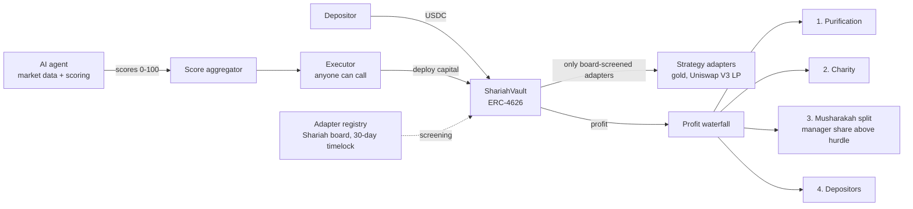

# DeFiVault Finance

**An AI-guided USDC vault on Arc, with a Shariah-screened tier built around profit sharing instead of interest.**

Built with [Arc Studio](https://studio.arc.io). Live on Arc mainnet as a hackathon demo.

| | |
|---|---|
| **Live app** | https://defi-vault-finance.vercel.app |
| **AI agent API** | https://defivault-finance-production.up.railway.app/status |
| **Vault (Arc mainnet)** | [`0xDc40ed79F74141BBba84d54f84Eafd43CD8Bc470`](https://explorer.arc.io/address/0xDc40ed79F74141BBba84d54f84Eafd43CD8Bc470) |
| **Example USDC deposit** | [`0xaec64e1e…c1011d`](https://explorer.arc.io/tx/0xaec64e1e7f47eecc6c32c6245df2283868bdf68a302f81f7c82069a0ffc1011d) |
| **Example USDC redeem** | [`0x0a734ab9…18e30de`](https://explorer.arc.io/tx/0x0a734ab9a97e8929e2eb2f07bcaaa41f4dc949efb1ca21e14e134376518e30de) |

> **Unaudited demo.** The mainnet contracts have not had an independent audit and no Shariah board has ruled on them yet. Use small amounts only. Details in [What is live today](#what-is-live-today).

---

## The problem

Yield in DeFi moves fast, and keeping capital in the best opportunity means watching many venues at once. For Muslim savers the problem is harder: most yield is interest-based, and products that claim to avoid interest rarely show how profit is shared, how non-permissible income is removed, or who decides what is allowed.

## What DeFiVault does

- **One USDC deposit, managed allocation.** Users deposit USDC into an ERC-4626 vault and receive shares. The vault deploys capital into approved strategies and prices shares from net asset value.
- **An AI agent picks the opportunity.** The agent reads live market data, scores each strategy from 0 to 100, and the highest-scoring permitted strategy can be executed by anyone, on-chain, once its score clears the tier's threshold.
- **A Shariah tier with the rules in code.** Profit is shared (Musharakah) rather than paid as interest. Every profit distribution runs a fixed waterfall: purification of non-permissible income, then a charity contribution, then the profit split. Strategies must be screened by a Shariah board before they can receive any funds.
- **Separate tiers, separate capital.** Conventional and Shariah vaults are independent deployments. Their funds never mix.

---

## How it works



1. **Deposit.** USDC goes into the vault and the depositor receives shares at the current net asset value.
2. **Score.** The agent pulls live data (Uniswap pools, Hyperliquid funding, Stargate flows, Aave and Ondo yields), scores each strategy and publishes the scores.
3. **Execute.** When the top permitted strategy clears the tier's minimum score, anyone can call `executeWinner()`. The executor enforces a cooldown, a gas-price ceiling, per-strategy size limits and the tier's allowed strategies.
4. **Value.** Losses on deployed capital are marked into the share price; gains count only once realized. Gold positions are priced from an oracle.
5. **Share profit.** Profit is split through the waterfall above. A user who exits settles their share of the waterfall at exit, so no one can leave others holding the distribution cost.
6. **Redeem.** Users redeem shares for USDC at any time, up to the idle liquidity the vault holds.

---

## The Shariah design

| Principle | How the code enforces it |
|---|---|
| Profit sharing, not interest | The manager earns a Musharakah share (10%) only of profit **above** a 4% hurdle, and nothing while depositors are below their previous high-water mark. A 0.5% yearly Wakala (agency) fee covers administration. |
| Remove non-permissible income | Purification is the first step of every profit distribution and goes straight to the charity wallet. |
| Give to charity | A charity contribution (default 2.5%) is the second step, before any split. |
| Only approved strategies | An adapter can receive funds only after the board screens it through a registry with a 30-day timelock and an expiry date, tied to a published pronouncement. |
| No sudden rule changes | Every Shariah parameter (charity rate and wallet, purification rate, dust threshold) changes only through a board proposal and a 30-day timelock. Hard safety caps are fixed in code. |
| Exit is always possible | Redemptions are never blocked by oracles or external dependencies, and there is no forced migration between vault versions. |

Strategies in the conservative Shariah tier: an atomic gold exchange (PAXG), a spot gold allocation (XAUT, oracle-checked, capped at 30% of the vault), and a Uniswap V3 liquidity position that earns swap fees. All of them are **pending board rulings**; the app labels them "screened, board ruling pending".

---

## The AI agent

The agent (`server/agent.ts`, running on Railway) is an **advisory scoring service**:

- Scans live sources every 30 to 60 seconds and scores each strategy from 0 to 100 with a plain-language signal (for example "20.7 bps max deviation").
- Runs an advisory Shariah screen (11 rules covering business activity, interest-bearing income and leverage) and flags each protocol PASS, REVIEW or FAIL. It never declares anything permissible; that is the board's role.
- Serves the scores and screening results to the app through `/status`, `/shariah` and `/tiers`.

Scores are written on-chain by the oracle role, and `executeWinner()` is permissionless. On testnet both steps were run live (see below). Wiring the agent to sign its own score updates is the next step on the roadmap.

---

## What is live today

### Arc mainnet (hackathon demo)

The core Shariah stack is deployed with the production deploy script, and real USDC has moved through it.

| Contract | Address |
|---|---|
| ShariahVaultV2 | [`0xDc40ed79F74141BBba84d54f84Eafd43CD8Bc470`](https://explorer.arc.io/address/0xDc40ed79F74141BBba84d54f84Eafd43CD8Bc470) |
| Adapter registry (30-day timelock) | [`0xb7b1cFEbB0390aA16945aCe518118d491016A793`](https://explorer.arc.io/address/0xb7b1cFEbB0390aA16945aCe518118d491016A793) |
| Executor | [`0x23836611FDF05fAc07a12416e9c8C250F9cdF671`](https://explorer.arc.io/address/0x23836611FDF05fAc07a12416e9c8C250F9cdF671) |
| Score aggregator | [`0x2b8dA7636aeb97C153F81C7168302dF45eD3643a`](https://explorer.arc.io/address/0x2b8dA7636aeb97C153F81C7168302dF45eD3643a) |
| Treasury | [`0xf17585cB249EF6Ab8bB450595107DB34d46FfE91`](https://explorer.arc.io/address/0xf17585cB249EF6Ab8bB450595107DB34d46FfE91) |
| Charity module | [`0x99D53De353d32e34F18a21c8c760424FC92D01a9`](https://explorer.arc.io/address/0x99D53De353d32e34F18a21c8c760424FC92D01a9) |
| Purification escrow | [`0x3dA4697D8154A794DaC1d63276072142ed7C1890`](https://explorer.arc.io/address/0x3dA4697D8154A794DaC1d63276072142ed7C1890) |

- A 1 USDC deposit and a full redeem went through the vault (links at the top).
- The bytecode on mainnet was checked against the source and matches.
- No strategy is funded yet: mainnet screening takes the real 30-day timelock and needs a board ruling, so deposits sit idle in the vault. Full record: [docs/mainnet-hackathon-demo.md](docs/mainnet-hackathon-demo.md).

### Arc Testnet (full flow)

On testnet the whole loop runs end to end, including a real Uniswap V3 position:

- We deployed the official Uniswap V3 contracts on Arc Testnet (byte-identical to Uniswap's Arc mainnet deployment) and seeded USDC/EURC pools.
- The liquidity adapter was screened through the registry, the agent's top score was written on-chain, and the permissionless `executeWinner()` funded a real LP position through the vault.
- Partial and full recall returned the capital at a 0.05% round-trip cost.
- 30-day governance proposals (emergency-exit flags, a slippage change, the dust threshold, a CCTP recipient) are pending, and one was cancelled to test the cancel path.

Transaction-by-transaction log: [docs/rehearsal.md](docs/rehearsal.md). Addresses: [docs/agents/deployed-addresses.md](docs/agents/deployed-addresses.md).

---

## Testing and security

- **2,097 Foundry tests passing**, including 8 protocol invariants (256 runs, depth 50) and fuzz tests on the profit waterfall, hurdle and exit accounting.
- **Fork tests against real Arc contracts:** Circle CCTP V2 on Arc Testnet, and the liquidity adapter against Uniswap's real USDC/EURC pool on an Arc mainnet fork.
- **Static analysis:** Slither and Aderyn, every high and medium result triaged ([docs/static-analysis.md](docs/static-analysis.md)).
- **Coverage:** about 96% of lines and branches on the vault and its libraries ([docs/coverage.md](docs/coverage.md)).
- **Internal security reviews:** 41 findings recorded, each fixed or accepted with a written reason ([docs/security-review.md](docs/security-review.md)).
- **Not yet done:** an independent audit, Shariah board rulings, and multisig governance. These are required before any real launch ([docs/mainnet-deploy.md](docs/mainnet-deploy.md)).

---

## Built with Arc Studio

The contracts, tests, agent and app were built in Arc Studio: Solidity contracts and Foundry tests, the Bun agent, the React app, and the deployment scripts for Arc Testnet and Arc mainnet.

## Tech stack

| Layer | Stack |
|---|---|
| Contracts | Solidity 0.8.28, Foundry, OpenZeppelin (ERC-4626) |
| Chain | Arc (USDC as gas), Circle CCTP V2 for cross-chain capital |
| AI agent | Bun, Express, viem (hosted on Railway) |
| App | React 18, Vite, TypeScript, Tailwind, wagmi and viem (hosted on Vercel) |

---

## Run it locally

```bash
bun install
bun run dev             # app on http://localhost:5173 (Arc Testnet by default)
bun run agent           # AI agent on http://localhost:3001
forge test              # contract tests
```

Build the app for Arc mainnet with `bunx vite build --mode mainnet` (addresses come from `.env.mainnet`).

## Repository layout

```
contracts/            Solidity contracts, adapters, Foundry tests and deploy scripts
  adapters/           Gold exchange, gold allocation and Uniswap V3 liquidity adapters
  script/             Testnet rehearsal, mainnet deploy, Uniswap V3 testnet deploy
  test/               Unit, fuzz, invariant and fork tests
server/               AI agent: market scanners, scoring, Shariah screening engine
src/                  React app
docs/                 Security review, deploy runbooks, rehearsal logs, audit package
```

---

## Roadmap

1. Independent security audit, then redeploy the audited code.
2. Shariah board rulings on the strategies and parameters; multisig governance.
3. Let the agent sign its own score updates and trigger execution.
4. Screen and fund the first strategies on mainnet (30-day timelock).
5. ShariahVaultV3 with Uniswap v4 liquidity.

---

*DeFiVault Finance is experimental software. It is not financial advice and has not been audited. Strategy screenings shown in the app are advisory until the Shariah board issues a ruling.*
