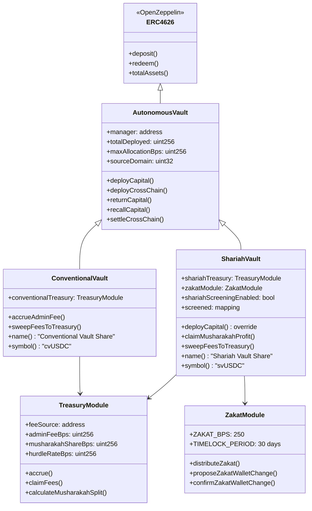
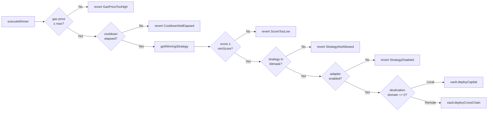
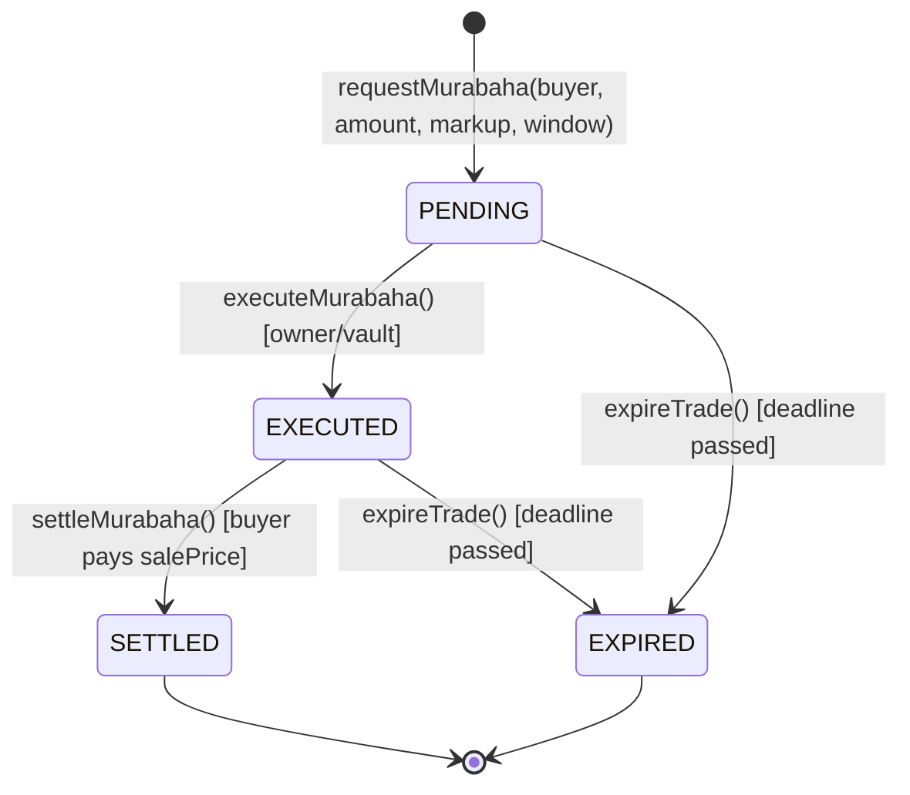
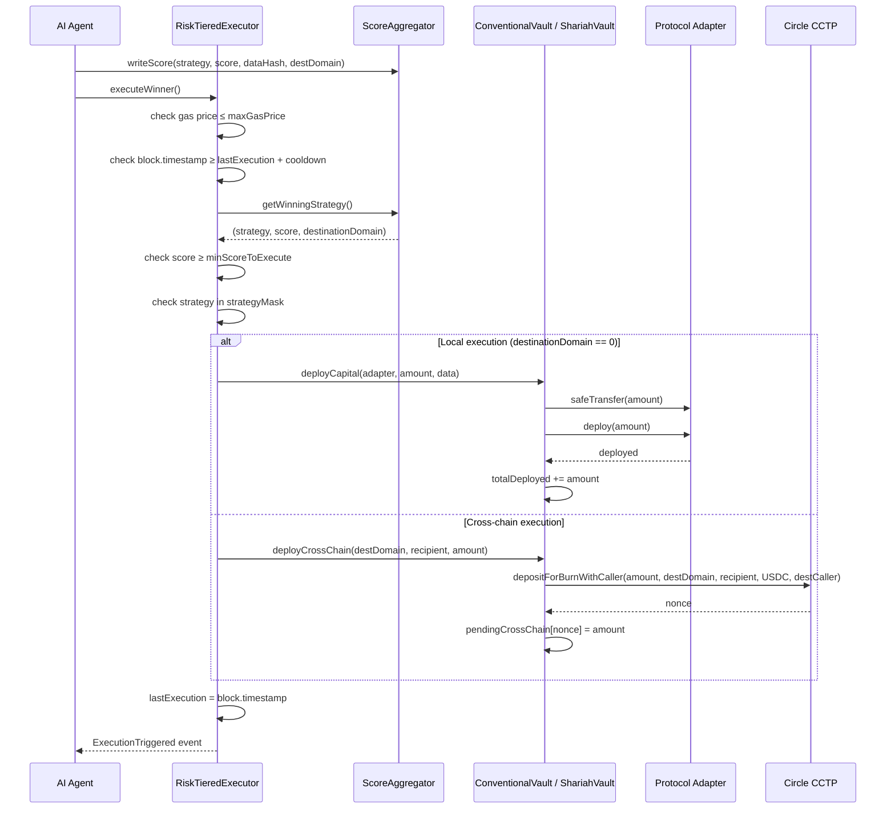
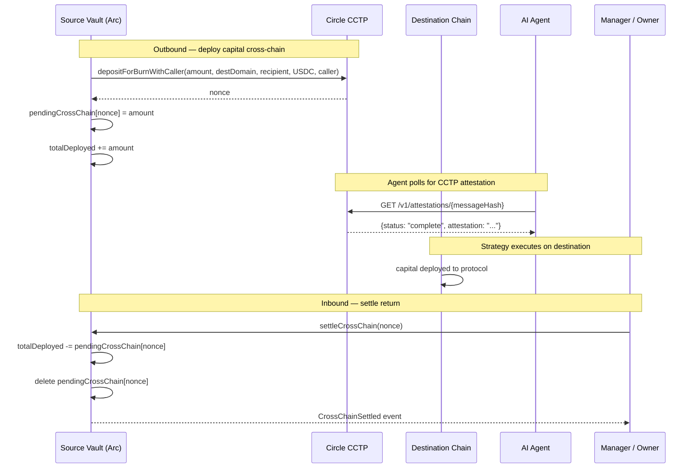
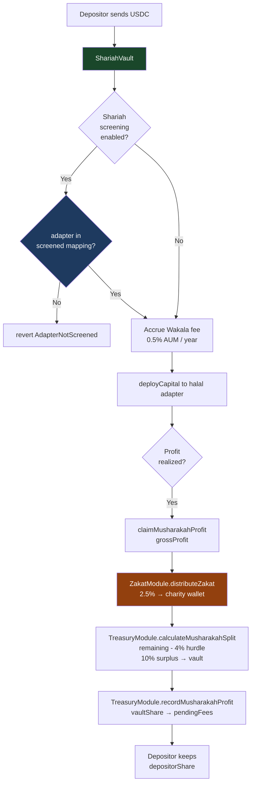
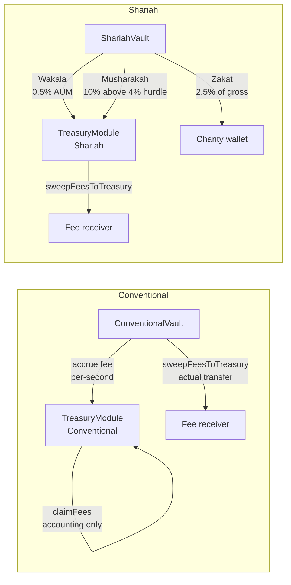
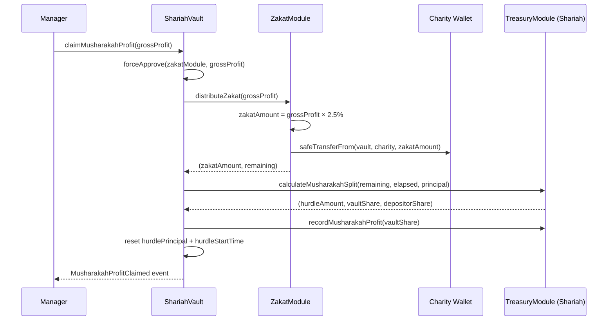

# DeFiVault Finance

**Autonomous, AI-powered DeFi capital allocation on Arc Testnet**  
Live at [defivault.finance](https://defivault.finance) · USDC-native · Halal-certified

DeFiVault is an ERC-4626 vault protocol with four risk tiers across two communities — Conventional and Shariah. An on-chain AI agent continuously scores strategies, routes capital through protocol adapters, and executes the winning strategy on every cycle. All fees are transparent and on-chain; Shariah vaults auto-route Zakat before any profit split.

---

## Table of Contents

1. [Architecture Overview](#architecture-overview)
2. [Vault Tiers](#vault-tiers)
3. [Contract Hierarchy](#contract-hierarchy)
4. [Core Contracts](#core-contracts)
5. [Strategy Adapters](#strategy-adapters)
6. [Agent Scoring System](#agent-scoring-system)
7. [Execution Workflow](#execution-workflow)
8. [Cross-Chain Flow](#cross-chain-flow)
9. [Shariah Compliance Workflow](#shariah-compliance-workflow)
10. [Fee Architecture](#fee-architecture)
11. [Zakat Distribution](#zakat-distribution)
12. [Security Model](#security-model)
13. [Test Coverage](#test-coverage)
14. [Deployment](#deployment)

---

## Architecture Overview

```mermaid
graph TB
    subgraph UI ["DeFiVault Frontend (React + Vite)"]
        LP[Landing Page]
        VP[Vault Picker]
        SP[Strategies Page]
        DP[Dashboard]
    end

    subgraph Agent ["AI Agent Server (Express)"]
        SA[Strategy Scorers]
        SS[Shariah Scorers]
        CP[CCTP Attestation Poller]
        AC[/api/status · /api/shariah · /api/tiers]
    end

    subgraph Conventional ["Conventional Vaults"]
        CV_P[ConventionalVault · Passive]
        CV_A[ConventionalVault · Aggressive]
        RTE_P[RiskTieredExecutor · PASSIVE]
        RTE_A[RiskTieredExecutor · AGGRESSIVE]
        AGG[ScoreAggregator]
        CT[TreasuryModule · Conventional]
    end

    subgraph Shariah ["Shariah Vaults"]
        SV_C[ShariahVault · Conservative]
        SV_D[ShariahVault · Dynamic]
        RTE_SC[RiskTieredExecutor · SHARIAH_CONSERVATIVE]
        RTE_SD[RiskTieredExecutor · SHARIAH_DYNAMIC]
        SAGG[ShariahScoreAggregator]
        ST[TreasuryModule · Shariah]
        ZM[ZakatModule]
    end

    subgraph Adapters ["Protocol Adapters"]
        COMP[CompoundAdapter]
        CURVE[CurveAdapter]
        AAVE[AaveLoopAdapter]
        GMX[GmxAdapter]
        HLP[HalalLPAdapter]
        MUR[CommodityMurabahaAdapter]
        RWA[RwaYieldAdapter]
    end

    CCTP[Circle CCTP · TokenMessengerV2]

    UI --> Agent
    SA --> AGG
    SS --> SAGG
    RTE_P --> CV_P
    RTE_A --> CV_A
    RTE_SC --> SV_C
    RTE_SD --> SV_D
    CV_P --> CT
    CV_A --> CT
    SV_C --> ST
    SV_C --> ZM
    SV_D --> ST
    SV_D --> ZM
    CV_P --> COMP
    CV_P --> CURVE
    CV_A --> AAVE
    CV_A --> GMX
    SV_C --> HLP
    SV_C --> RWA
    SV_D --> HLP
    SV_D --> MUR
    SV_D --> RWA
    CV_P --> CCTP
    CV_A --> CCTP
    SV_C --> CCTP
    SV_D --> CCTP
```

---

## Vault Tiers

| Tier | Type | Strategies | Min Score | Cooldown | Fee Model |
|---|---|---|---|---|---|
| **Passive** | Conventional | S1 Cross-chain Spread, S4 RWA Yield | 80 | 2h | 0.75% AUM |
| **Aggressive** | Conventional | S1–S4 all | 60 | 30m | 0.75% AUM |
| **Conservative** | Shariah | S2-H Gold Spread, S3-H Halal LP, S5-H RWA Sukuk | 80 | 2h | 0.5% Wakala |
| **Dynamic** | Shariah | All 5 Shariah strategies | 70 | 1h | 0.5% Wakala + 10% Musharakah |

Each tier is a separate vault deployment (independent NAV, independent share token) — capital from one tier never mixes with another.

---

## Contract Hierarchy



---

## Core Contracts

### `AutonomousVault.sol`

Base ERC-4626 vault. All four tier vaults inherit this.

| Feature | Detail |
|---|---|
| Asset | USDC (6 decimals) |
| Share decimals offset | +6 (12 total) — inflation-attack protection |
| Max allocation cap | 80% of `totalAssets()` by default (configurable up to 95%) |
| Manager role | Single address that can call `deployCapital` and `deployCrossChain` |
| CCTP | Immutable `sourceDomain` set at construction; `tokenMessenger` configurable |
| Cross-chain accounting | `pendingCrossChain[nonce]` tracks outbound capital until `settleCrossChain` |

Key functions:

```solidity
function deployCapital(address strategy, uint256 amount, bytes calldata data) public virtual
function deployCrossChain(uint32 destDomain, bytes32 recipient, uint256 amount) external
function returnCapital(address strategy, uint256 amount) external
function recallCapital(address adapter, uint256 amount) external
function settleCrossChain(uint64 nonce) external
```

### `ConventionalVault.sol`

Inherits `AutonomousVault`. Adds admin fee accrual (0.75% AUM, pro-rated per second).

### `ShariahVault.sol`

Inherits `AutonomousVault`. Overrides `deployCapital` to enforce:
1. Adapter must be in `screened` mapping
2. Asset must be in `permittedAssets` mapping (USDC, ETH, PAXG, OUSG, USDT, BUIDL)
3. Wakala fee accrued on every deployment

### `RiskTieredExecutor.sol`

One instance per vault tier. Reads the winning strategy from the aggregator and routes execution.



Tier parameters:

| Tier | `minScoreToExecute` | `executionCooldown` | `maxGasPrice` | `strategyMask` |
|---|---|---|---|---|
| PASSIVE | 80 | 2h | 20 gwei | `0b1001` (S0+S3) |
| AGGRESSIVE | 60 | 30m | 50 gwei | `0b1111` (S0–S3) |
| SHARIAH_CONSERVATIVE | 80 | 2h | 30 gwei | `0b01110` (bits 1+2+3) |
| SHARIAH_DYNAMIC | 70 | 1h | 30 gwei | `0b11111` (all 5) |

### `ScoreAggregator.sol`

Stores scores for 4 conventional strategies. Ring-buffer of 10 history slots per strategy. 5-minute staleness guard.

```solidity
enum Strategy {
    STABLECOIN_SPREAD,    // S1 — USDC/USDT cross-chain
    FUNDING_RATE_ARB,     // S2 — Hyperliquid perp funding
    BRIDGE_FLOW,          // S3 — Stargate bridge flow
    LIQUIDATION_RWA       // S4 — Aave liquidation + Ondo RWA
}
```

### `ShariahScoreAggregator.sol`

Parallel aggregator for 5 Shariah strategies. Adds `shariahCertified` bool per strategy — only certified strategies can win.

```solidity
enum ShariahStrategy {
    ETH_SPREAD,    // S1-H USDC/ETH cross-chain spread
    GOLD_SPREAD,   // S2-H PAXG/USDC spread
    HALAL_LP,      // S3-H Uniswap V3 fee APY
    MURABAHA,      // S4-H Commodity Murabaha
    RWA_SUKUK      // S5-H OUSG/BUIDL yield
}
```

### `TreasuryModule.sol`

Accounting-only fee ledger. Actual USDC transfer happens only when the vault calls `sweepFeesToTreasury`.

- **Conventional**: `adminFeeBps = 75` (0.75%), `musharakahShareBps = 0`
- **Shariah**: `adminFeeBps = 50` (0.5% Wakala), `musharakahShareBps = 1000` (10%), `hurdleRateBps = 400` (4%)

`claimFees` is accounting-only — it decrements `pendingFees` and emits the event; the caller must separately trigger `sweepFeesToTreasury` on the vault to move actual tokens. Fee sweeps are capped to `pendingFees` to prevent draining depositor principal.

### `ZakatModule.sol`

Auto-routes 2.5% of Shariah gross profit to a charity wallet before the Musharakah split.

- Zakat rate: fixed at `ZAKAT_BPS = 250` (2.5%), non-adjustable
- Wallet changes: 30-day timelock via `proposeZakatWalletChange` → `confirmZakatWalletChange`
- Only the bound vault can call `distributeZakat`

### `PositionTracker.sol`

Tracks open positions per vault, including cross-chain `destinationDomain`, PnL accounting, and position lifecycle (OPEN → CLOSED).

---

## Strategy Adapters

All adapters implement `IStrategyAdapter`:

```solidity
interface IStrategyAdapter {
    function deploy(uint256 amount) external returns (uint256 deployed);
    function recall(uint256 amount) external returns (uint256 returned);
    function currentValue() external view returns (uint256);
    function protocolName() external view returns (string memory);
    function vault() external view returns (address);
}
```

Only the vault can call `deploy` and `recall` (enforced by `onlyVault` modifier on every adapter).

| Adapter | Protocol | Tier(s) | Strategy |
|---|---|---|---|
| `CompoundAdapter` | Compound V3 Comet | Passive | S1 |
| `CurveAdapter` | Curve 3pool LP | Passive | S4 |
| `AaveLoopAdapter` | Aave V3 2× leverage | Aggressive | S2 |
| `GmxAdapter` | GMX V2 GLP | Aggressive | S3 |
| `HalalLPAdapter` | Uniswap V3 USDC/ETH or USDC/PAXG | Conservative + Dynamic | S3-H |
| `CommodityMurabahaAdapter` | Murabaha trade lifecycle | Dynamic | S4-H |
| `RwaYieldAdapter` | OUSG / BUIDL direct hold | Conservative + Dynamic | S5-H |

### `CommodityMurabahaAdapter` — Trade Lifecycle



- Max 50 concurrent active trades (DoS guard)
- O(1) removal via index mapping + swap-and-pop
- Buyer pays `costAmount + markup` directly to vault on settlement

---

## Agent Scoring System

The Express agent (`server/agent.ts`) runs continuously alongside the frontend. Each strategy has its own scorer with a configurable interval.

```mermaid
flowchart TD
    subgraph Conventional Scorers
        S1[S1 scorer\n30s interval\nUniswap + CEX spread]
        S2[S2 scorer\n30s interval\nHyperliquid funding rate]
        S3[S3 scorer\nevent-driven\nStargate bridge volume]
        S4[S4 scorer\n45s interval\nAave + Ondo RWA yield]
    end

    subgraph Shariah Scorers
        SH1[ETH Spread scorer\n60s interval]
        SH2[Gold Spread scorer\n60s interval]
        SH3[Halal LP scorer\n60s interval]
        SH4[Murabaha scorer\nevent-driven]
        SH5[RWA Sukuk scorer\n120s interval]
    end

    subgraph Protocol Signals
        PS[fetchProtocolSignals\n60s interval\nCompound APY · Curve APY\nAave loop rate · GMX GLP APY]
    end

    S1 & S2 & S3 & S4 --> AGG_W[ScoreAggregator.writeBatchScores]
    SH1 & SH2 & SH3 & SH4 & SH5 --> SAGG_W[ShariahScoreAggregator.writeBatchScores]
    PS --> S1 & S2 & S3 & S4

    AGG_W --> API[/api/status]
    SAGG_W --> SHARIAH_API[/api/shariah]
```

All agent intervals and thresholds are hot-reloadable via `POST /api/config`.

---

## Execution Workflow



---

## Cross-Chain Flow



---

## Shariah Compliance Workflow



**Permitted Shariah assets:** USDC, USDT, ETH, PAXG, OUSG, BUIDL  
**Prohibited actions:** Aave lending (riba), perp funding payments, front-running MEV

---

## Fee Architecture



| Fee | Rate | Mechanism | When |
|---|---|---|---|
| Admin fee (Conventional) | 0.75% AUM / year | Pro-rated per second, accounting-only | On every `deployCapital` |
| Wakala fee (Shariah) | 0.5% AUM / year | Pro-rated per second | On every Shariah `deployCapital` |
| Musharakah profit share | 10% of profit above 4% hurdle | Applied on `claimMusharakahProfit` | When manager claims |
| Zakat | 2.5% of gross Musharakah profit | Auto-routed before Musharakah split | First, before any split |

---

## Zakat Distribution



**Zakat wallet changes require a 30-day timelock:**

```
proposeZakatWalletChange(newWallet)  →  wait 30 days  →  confirmZakatWalletChange()
```

---

## Security Model

| Threat | Mitigation |
|---|---|
| Inflation attack | `_decimalsOffset = 6` on all vaults (shares have 12 decimals, USDC has 6) |
| Principal drain via fee sweep | `sweepFeesToTreasury` capped to `TreasuryModule.pendingFees` |
| Shariah screening bypass | `deployCapital` overridden in `ShariahVault`; base function is `virtual` |
| Unlimited trade DoS | `CommodityMurabahaAdapter` enforces `MAX_ACTIVE_TRADES = 50` |
| O(n) removal DoS | Active trade removal uses index mapping + swap-and-pop (O(1)) |
| Over-allocation | `maxAllocationBps` cumulative cap (default 80%) enforced on every deployment |
| Stale oracle execution | 5-minute staleness guard in both score aggregators |
| Gas price manipulation | `maxGasPrice` guard per tier in `RiskTieredExecutor` |
| Cross-chain double-settle | `settleCrossChain` deletes `pendingCrossChain[nonce]` atomically |
| Same-domain CCTP loop | `deployCrossChain` reverts `SameDomainDeploy` if `destDomain == sourceDomain` |
| Zakat wallet rug | 30-day timelock on all `ZakatModule` wallet changes |
| RWA lending exposure | `RwaYieldAdapter` has no approve-for-lending function by design |

---

## Test Coverage

145 tests — 88 unit + 57 fuzz — across 12 test files in `contracts/test/`.

| File | Tests | Type | Coverage |
|---|---|---|---|
| `AutonomousVaultTest.t.sol` | 17 | Unit | Deposit, redeem, deploy, cap, cross-chain, pause, inflation |
| `ScoreAggregatorTest.t.sol` | 13 | Unit | Write, batch, staleness, ring-buffer, access control |
| `RiskTieredExecutorTest.t.sol` | 12 | Unit | Execute, cooldown, gas guard, bitmask, tier params |
| `TreasuryModuleTest.t.sol` | 16 | Unit | Accrue, claim, Musharakah split, bps guards |
| `ZakatModuleTest.t.sol` | 12 | Unit | Distribute, timelock, propose/confirm/cancel |
| `CommodityMurabahaAdapterTest.t.sol` | 18 | Unit | Request, execute, settle, expire, DoS guard |
| `FuzzAutonomousVault.t.sol` | 10 | Fuzz (512 runs) | Round-trip, multi-depositor fairness, cap at all amounts |
| `FuzzScoreAggregator.t.sol` | 9 | Fuzz (512 runs) | Winner invariant, ring-buffer, staleness, access control |
| `FuzzRiskTieredExecutor.t.sol` | 11 | Fuzz (512 runs) | Score/cooldown/gas guards at all param values |
| `FuzzTreasuryModule.t.sol` | 8 | Fuzz (512 runs) | Split invariant: vaultShare + depositorShare == grossProfit |
| `FuzzZakatModule.t.sol` | 9 | Fuzz (512 runs) | Zakat exactly 2.5%, timelock boundary, accumulation |
| `FuzzCommodityMurabaha.t.sol` | 9 | Fuzz (512 runs) | Sale price math, O(1) removal, max-trade cap |

Run the full suite:

```bash
forge test --fuzz-runs 512
```

Run a single file:

```bash
forge test --match-path contracts/test/AutonomousVaultTest.t.sol -vv
```

---

## Deployment

All contracts deploy to **Arc Testnet** (chain ID 2911) with USDC as the native gas token.

**Deploy order (respects dependency graph):**

```
1. TreasuryModule (Conventional)         — no deps
2. TreasuryModule (Shariah)              — no deps
3. ZakatModule × 2                       — no deps (one per Shariah vault)
4. ScoreAggregator                       — no deps
5. ShariahScoreAggregator                — no deps
6. ConventionalVault (Passive)           — needs TreasuryModule
7. ConventionalVault (Aggressive)        — needs TreasuryModule
8. ShariahVault (Conservative)           — needs TreasuryModule + ZakatModule
9. ShariahVault (Dynamic)                — needs TreasuryModule + ZakatModule
10. RiskTieredExecutor × 4               — needs vault + aggregator
11. Adapters × 7                         — needs vault address
12. setManager(executor) on each vault   — wires executor as manager
13. setStrategyConfig per adapter        — configures each adapter per tier
14. setCertified(strategy, true) ×5      — Shariah board certifies strategies
```

**Constructor args quick reference:**

```solidity
// TreasuryModule
constructor(
    "Conventional",         // treasuryType
    address(conventionalVault),  // feeSource
    address(USDC),          // asset
    75,                     // adminFeeBps (0.75%)
    0,                      // musharakahShareBps
    0,                      // hurdleRateBps
    owner                   // initialOwner
)

// ShariahVault
constructor(
    IERC20(USDC),
    owner,
    26,                     // sourceDomain (Arc Testnet CCTP domain)
    address(shariahTreasury),
    address(zakatModule)
)

// RiskTieredExecutor (PASSIVE)
constructor(
    address(passiveVault),
    address(scoreAggregator),
    RiskTier.PASSIVE,
    owner
)
```

**Key addresses (Arc Testnet):**

| Contract | Address |
|---|---|
| USDC (ERC-20) | `0x3c499c542cEF5E3811e1192ce70d8cC03d5c3359` |
| CCTP TokenMessengerV2 | `0x8FE6B999Dc680CcFDD5Bf7EB0974218be2542DAA` |
| Arc Testnet CCTP source domain | `26` |

All deployed vault addresses are recorded in `AGENTS.md` after deployment.

---

## Project Structure

```
contracts/
├── AutonomousVault.sol          # Base ERC-4626 vault
├── ConventionalVault.sol        # Conventional tier (admin fee)
├── ShariahVault.sol             # Shariah tier (Wakala + Musharakah)
├── ScoreAggregator.sol          # 4-strategy conventional scorer
├── ShariahScoreAggregator.sol   # 5-strategy Shariah scorer
├── RiskTieredExecutor.sol       # Strategy router (4 tiers)
├── TreasuryModule.sol           # Fee accounting module
├── ZakatModule.sol              # Auto Zakat router (30-day timelock)
├── PositionTracker.sol          # Position lifecycle + PnL
├── IStrategyAdapter.sol         # Adapter interface
├── VaultExecutor.sol            # Legacy executor (superseded)
├── adapters/
│   ├── CompoundAdapter.sol      # Compound V3 Comet
│   ├── CurveAdapter.sol         # Curve 3pool LP
│   ├── AaveLoopAdapter.sol      # Aave V3 2x leverage
│   ├── GmxAdapter.sol           # GMX V2 GLP
│   ├── HalalLPAdapter.sol       # Uniswap V3 halal LP
│   ├── CommodityMurabahaAdapter.sol  # Murabaha trade lifecycle
│   └── RwaYieldAdapter.sol      # OUSG / BUIDL direct hold
└── test/
    ├── *Test.t.sol              # 88 unit tests
    └── Fuzz*.t.sol              # 57 fuzz tests (512 runs each)

server/
├── agent.ts                     # AI agent (scoring + execution)
└── shariah-strategies.ts        # Shariah strategy scorers

src/
├── App.tsx                      # Router + vault-mode state
├── pages/                       # 6 route pages
├── components/                  # UI components
└── lib/shariahSim.ts            # Simulated scores (pre-deploy)
```

---

*DeFiVault Finance — Built on [Arc Testnet](https://arc.io) · Powered by [Circle USDC](https://circle.com)*
